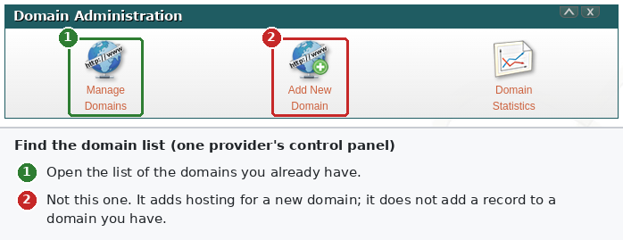
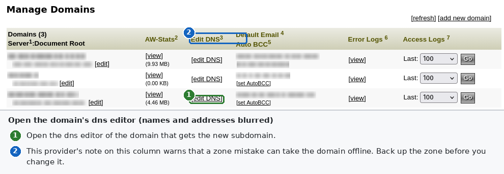
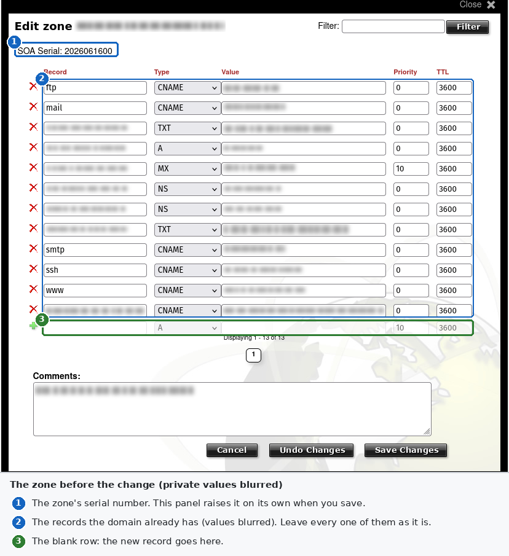
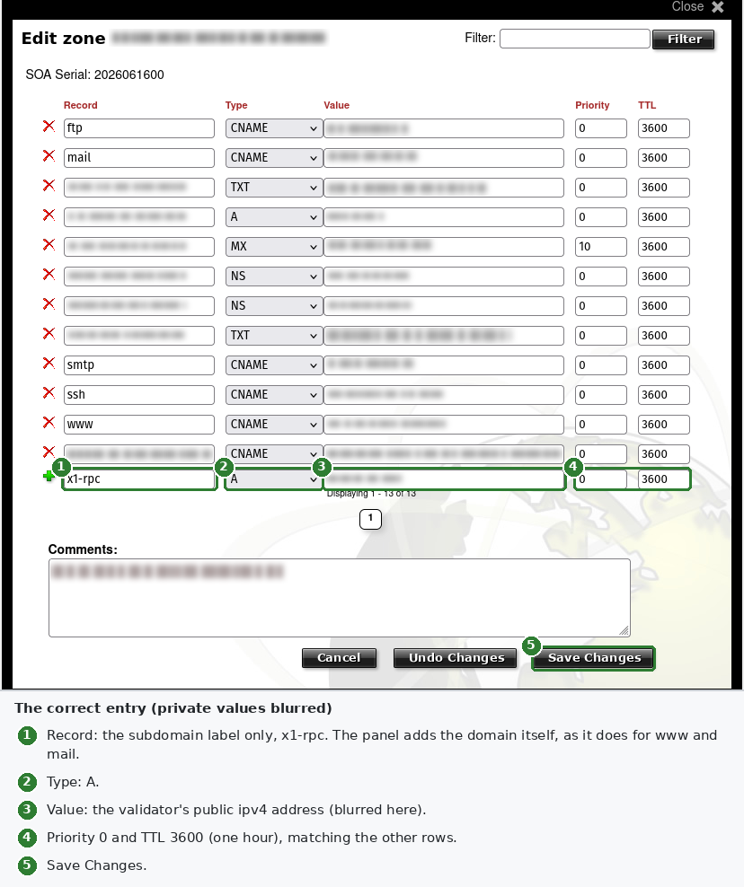
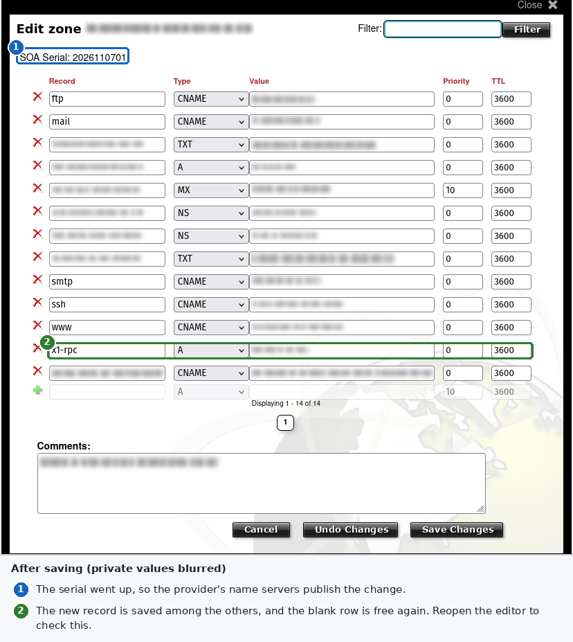
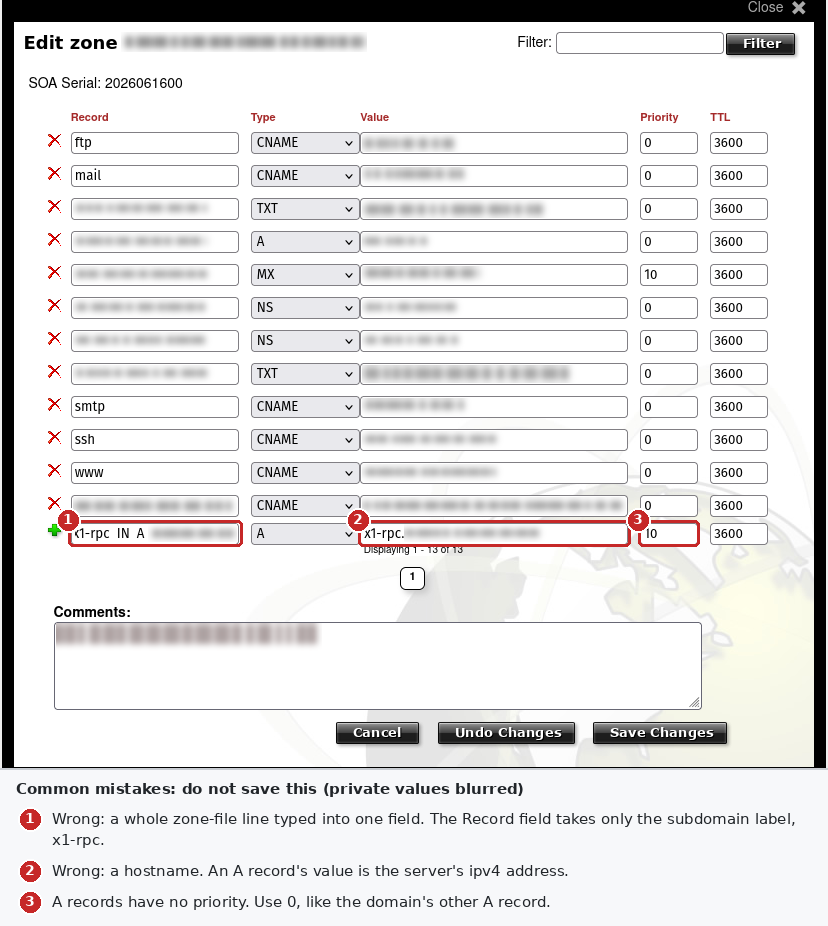

# x1-validator-private-rpc: Hand-off

This file hands off a new public project, `x1-validator-private-rpc`. It is a Node.js command-line tool for X1 validators that x1console manages. It makes the validator's rpc private and puts it behind an https address that carries an api key.

It is written for whoever builds the project, a person or a Claude Code session. It records what was checked in the sources, on a live validator, and in a test container and a test virtual machine. It also records the owner's decisions, the design that follows from them, and the conventions the code must follow. It ends with a manual guide to the one step the tool does not automate: the dns record.

Two folders come with this file:

- `docs/images/dns/` holds six images of one provider's form-based dns editor, with every private value blurred. They are meant for the project's user manual.
- `reference/` holds the nginx configuration, the key check, the start wrapper, the systemd drop-in and the logrotate rule that passed the tests, and the tests themselves. Its README says what each file becomes in the project.

## Table of Contents

- [Summary](#summary)
  - [Placeholders Used Here](#placeholders-used-here)
- [Decisions by the Owner](#decisions-by-the-owner)
  - [Alternatives Considered](#alternatives-considered)
- [What the Tool Does](#what-the-tool-does)
  - [In Scope](#in-scope)
  - [Out of Scope](#out-of-scope)
- [Verified Facts About the Target Setup](#verified-facts-about-the-target-setup)
  - [x1console](#x1console)
    - [How It Starts the Validator](#how-it-starts-the-validator)
    - [How It Opens the Firewall](#how-it-opens-the-firewall)
    - [What It Needs From Port 8899](#what-it-needs-from-port-8899)
    - [Whether It Updates Itself](#whether-it-updates-itself)
    - [Its Telegram Alerts](#its-telegram-alerts)
  - [Tachyon](#tachyon)
    - [Where the RPC Server Binds](#where-the-rpc-server-binds)
    - [The Start-Up Port Check](#the-start-up-port-check)
    - [The Validator's Own Commands](#the-validators-own-commands)
  - [nginx and Its Modules](#nginx-and-its-modules)
    - [The Packages](#the-packages)
    - [What Installing the Package Does](#what-installing-the-package-does)
    - [Certificates Through Port 443 Alone](#certificates-through-port-443-alone)
    - [The Key From the Environment](#the-key-from-the-environment)
    - [What nginx Logs](#what-nginx-logs)
  - [The Validator Host](#the-validator-host)
    - [Node.js Version](#nodejs-version)
    - [systemd and Encrypted Credentials](#systemd-and-encrypted-credentials)
    - [Privileges](#privileges)
    - [Testing Reachability From the Server Itself](#testing-reachability-from-the-server-itself)
- [Design](#design)
  - [Request Path](#request-path)
  - [Commands](#commands)
  - [Stages of Apply](#stages-of-apply)
  - [The Start-Script Edit](#the-start-script-edit)
  - [Keeping the Flag Through Console Updates](#keeping-the-flag-through-console-updates)
  - [The nginx Setup](#the-nginx-setup)
    - [Installing nginx](#installing-nginx)
    - [The Configuration](#the-configuration)
    - [The Key Check](#the-key-check)
    - [The Gate Page](#the-gate-page)
    - [The Certificate](#the-certificate)
    - [Logs and Rotation](#logs-and-rotation)
  - [The API Key and the Password](#the-api-key-and-the-password)
    - [The Vault](#the-vault)
    - [Saving the Password](#saving-the-password)
    - [Running Without a Saved Password](#running-without-a-saved-password)
    - [The Start Wrapper](#the-start-wrapper)
    - [Changing the Key or the Password](#changing-the-key-or-the-password)
  - [Alerts](#alerts)
  - [Firewall](#firewall)
  - [Restarting the Validator](#restarting-the-validator)
  - [Verification Checks](#verification-checks)
  - [Logging, Output and Exit Codes](#logging-output-and-exit-codes)
- [Configuration Files and Examples](#configuration-files-and-examples)
  - [Layout](#layout)
  - [Shipped Defaults](#shipped-defaults)
  - [Operator Overrides](#operator-overrides)
  - [Example Files](#example-files)
    - [Override Example](#override-example)
    - [nginx Configuration Example](#nginx-configuration-example)
    - [systemd Drop-In Example](#systemd-drop-in-example)
    - [Logrotate Example](#logrotate-example)
    - [Apt Source and Pin Examples](#apt-source-and-pin-examples)
    - [Scheduled Ensure Example](#scheduled-ensure-example)
    - [Git Hook Example](#git-hook-example)
  - [Validation](#validation)
- [Testing and Coverage](#testing-and-coverage)
  - [Coverage Gate](#coverage-gate)
  - [Node Versions](#node-versions)
  - [Unit Tests](#unit-tests)
  - [Integration Tests](#integration-tests)
  - [What Unit Tests Must Never Touch](#what-unit-tests-must-never-touch)
  - [Tested Before This Hand-off](#tested-before-this-hand-off)
- [Conventions From LP Ranger](#conventions-from-lp-ranger)
  - [Where to Read Them](#where-to-read-them)
  - [Code](#code)
  - [Lint and Format](#lint-and-format)
  - [Docs and Prose](#docs-and-prose)
  - [Git, CI and Releases](#git-ci-and-releases)
  - [Public-Repo Hygiene](#public-repo-hygiene)
- [Repository Layout](#repository-layout)
- [Acceptance Criteria](#acceptance-criteria)
- [Rollout on a Live Validator](#rollout-on-a-live-validator)
- [Manual Domain Setup](#manual-domain-setup)
  - [What You Are Setting Up](#what-you-are-setting-up)
  - [Before You Start](#before-you-start)
    - [Choose the Subdomain](#choose-the-subdomain)
    - [Find the Server's Public Address](#find-the-servers-public-address)
    - [Find Who Hosts Your DNS](#find-who-hosts-your-dns)
    - [Check for Records That Get in the Way](#check-for-records-that-get-in-the-way)
    - [Back Up the Zone](#back-up-the-zone)
  - [Form-Based DNS Editors](#form-based-dns-editors)
    - [Open the Zone Editor](#open-the-zone-editor)
    - [Field Names Across Providers](#field-names-across-providers)
    - [Adding the Record](#adding-the-record)
    - [Mistakes to Avoid](#mistakes-to-avoid)
  - [Raw Zone-File Editors](#raw-zone-file-editors)
    - [The Record Line](#the-record-line)
    - [Relative and Absolute Names](#relative-and-absolute-names)
    - [The SOA Serial](#the-soa-serial)
    - [Checking the File](#checking-the-file)
  - [Provider Settings That Matter](#provider-settings-that-matter)
  - [Verifying the Record](#verifying-the-record)
  - [Certificates and the New Hostname](#certificates-and-the-new-hostname)
  - [Changing or Removing the Record](#changing-or-removing-the-record)
  - [Troubleshooting](#troubleshooting)
- [Open Questions for the Owner](#open-questions-for-the-owner)

## Summary

- **The problem.** x1console starts Tachyon with the full rpc api, transaction history included, on port 8899. The rpc listens on every network interface and is advertised to the network. x1console's installer also opens tcp ports 8000–10000 in ufw. So anyone on the internet can query the validator, and every query competes with voting for the machine. On a live validator, a request from outside the data center to port 8899 got an answer, both for `/health` and for a transaction-history query.
- **The fix.** Add `--private-rpc` to x1console's start script. The rpc then listens on 127.0.0.1 only and is no longer advertised. Put nginx in front of it, listening on the validator's public address, port 443 only. nginx forwards only requests whose url path starts with a long random key. It refuses every other request with a 403 before the request reaches the validator. It takes request bodies of at most 10 KB, and never writes a response to disk. nginx's own ACME module gets and renews the Let's Encrypt certificate through port 443.
- **The key.** It is encrypted with the x1-validator-services password, the way LP Ranger's command-line version stores private keys. The password can be saved for unattended starts, encrypted by systemd. Otherwise the owner types it after each restart of nginx.
- **The tool's job.** Make that setup and check it every minute. Keep it in place across x1console updates, alert on Telegram when something is wrong, and undo it on request. The dns record stays manual; [Manual Domain Setup](#manual-domain-setup) covers it.
- **The owner's reference validator** already has its dns record. Nothing else from this design is applied there yet, so its rpc is still public.

The constraints, in one place:

- The tool runs on the validator under Node.js 20.0.0, the version x1console installs. Node.js never faces the internet; nginx does.
- Never breaks the validator, x1console, its Autopilot or its pinger. Together these make up the heartbeat and monitoring the owner relies on.
- Never restarts the validator on its own.
- The key and the password never reach the disk or a log in the clear.
- Adds nothing that listens on the loopback address.
- Public repository: no real hostname, address, user name or key anywhere in it.
- 90% line coverage, enforced by `npm run check`.
- Follows every generic convention of LP Ranger. See [Conventions From LP Ranger](#conventions-from-lp-ranger).
- Ships a copyable, easily customized example for every configuration file. See [Configuration Files and Examples](#configuration-files-and-examples).

### Placeholders Used Here

| Placeholder | Stands for |
| --- | --- |
| `example.com` | A domain the operator owns |
| `x1-rpc` | The subdomain label chosen for the rpc |
| `x1-rpc.example.com` | The full hostname of the rpc proxy |
| `203.0.113.10` | The validator's public ipv4 address (a documentation address) |
| `KEY` | The 64-character hex api key |
| `VALIDATOR_USER` | The Linux account that runs the validator and owns `~/x1console` |
| `you@example.com` | The operator's e-mail address |
| `ns1.dns-provider.example` | One of the dns provider's name servers |

## Decisions by the Owner

| Topic | Decision |
| --- | --- |
| Module system | ES modules: `"type": "module"` in `package.json` |
| License | Apache-2.0, as LP Ranger |
| Executable | One name, `x1-validator-private-rpc`, with no shorter alias |
| Coverage | 90% of lines. Branch coverage is reported, not enforced |
| Proxy | nginx from nginx.org, with its ACME and njs modules. See [Alternatives Considered](#alternatives-considered) |
| Ports | 443 only. Port 80 stays closed |
| Address | `https://x1-rpc.example.com/KEY`: a subdomain, with the key as the first part of the path |
| The key's storage | Encrypted with the x1-validator-services password, as LP Ranger's command-line version stores keys. The same password may later unlock secrets for other validator services |
| Unattended start | Optional. `apply` asks whether to save the password with systemd's encrypted credentials. Without it, the rpc stays locked after a restart of nginx until the owner runs `unlock` |
| Logs | The key never reaches a log. Short log retention is a second layer |
| The scheduled `ensure` | Runs every minute. `apply` offers to install it |
| Alerts | Telegram, through the bot x1console already uses. The owner does not read the server's e-mail |
| Validator restarts | Left to x1console. The tool prints what to do and when |
| TPM2 check | The first step of the rollout, and of `apply`: `systemd-creds has-tpm2` shows whether a saved password would be tied to the machine's TPM2 chip |
| First real certificate | From Let's Encrypt's staging service on the validator, then from production |
| Size limits on the rpc route | Request bodies of at most 10 KB, held in memory; a larger one gets a 413. nginx never writes an rpc response to disk |

The owner expects that x1console's author may add a private-rpc option one day. If the start script then carries `--private-rpc` already, `ensure` finds it in place and changes nothing.

### Alternatives Considered

- **Caddy.** It handles certificates well, and every test of it passed. But it does much by default that has to be switched off. It listens on every address. It runs an admin api on `localhost:2019` that any local program can use to change its configuration. It saves its configuration to disk, and opens a udp port for http/3. For any site named `localhost` or an ip address, it creates its own certificate authority and tries to add it to the system's trusted certificates. The owner wants software that starts minimal on a validator.
- **A proxy written in Node.js.** The project would own every line. But x1console's Node.js 20.0.0 must not face the internet. Node.js 20 reached end of life on 2026-04-30[^node-eol], and 20.0.0 has known request-smuggling flaws[^node-cve]. The proxy would need its own current Node.js, kept up to date, and its own certificate code.
- **nginx with certbot.** certbot adds its own timer, and usually needs port 80. nginx's native ACME module needs neither.
- **A throwaway server for the first real certificate.** It would have met Let's Encrypt without touching the validator. The owner chose Let's Encrypt's staging service on the validator instead.

## What the Tool Does

### In Scope

1. Checks the host: Ubuntu 24.04 or later, with systemd 250 or newer, apt, ufw, and x1console with its start script in the expected shape. It also checks that nothing else uses port 443, that the public address is on a local interface, and that the hostname resolves to this validator. It reports whether the machine has a TPM2 chip.
2. Installs nginx and its njs and ACME modules from nginx.org's apt repository, without ever running nginx's default site.
3. Opens tcp port 443 in ufw.
4. Creates the api key and encrypts it with the x1-validator-services password. Optionally saves the password for unattended starts.
5. Writes the nginx configuration, the key check and the start wrapper, and starts nginx.
6. Adds `--private-rpc` to x1console's start script.
7. Checks each step, and the whole request path, from the server.
8. Every minute, puts the flag back after an x1console update removes it. Alerts on Telegram when the running validator's rpc is public, nginx is down or locked, or the certificate nears expiry.
9. Unlocks nginx after a restart when the password is not saved. Replaces the key or the password, prints the full url on request, and undoes everything it did.

### Out of Scope

- **The dns record.** Every provider's panel differs, and editing a zone needs the owner's login. The tool checks the record; the owner creates it by hand.
- **Restarting the validator.** A restart takes the validator offline while it reloads and catches up, and it can cost leader slots. The tool says when a restart is needed and how to do it in x1console. The operator picks the moment.
- **Rate limits for keyed requests.** The key is the gate. If it leaks, `rotate-key` replaces it. Per-key rate limits are a possible later addition.
- **Hosts that already serve https.** If something else listens on port 443, or nginx already serves other sites, `apply` stops and explains.
- **Servers behind address translation.** nginx listens on the public address, so that address must be on one of the server's own interfaces. `apply` stops when it is not.
- **Other layouts.** Validators not set up by x1console, and systems other than Ubuntu.

## Verified Facts About the Target Setup

Each fact below was read in source code at the commits named in the footnotes, unless it says otherwise. Facts marked as tested were checked on 2026-11-11, in a disposable Ubuntu 24.04 container or an Ubuntu 24.04 virtual machine with systemd 255; [Tested Before This Hand-off](#tested-before-this-hand-off) lists them. Facts marked as observed were seen on the owner's live validator. x1console, Tachyon and nginx all change. Re-check a fact against the current sources before building on it. On 2026-11-11, x1console's newest commit was `c1ef91b`, of 2026-11-10, which changed only how it shows stake status; the cited Tachyon branch, x1-pinger and LP Ranger had not moved. On 2026-11-12, no file in x1console's history, 338 commits on its only branch, had ever contained `--private-rpc` or `--rpc-bind-address`. The owner then asked x1console's maintainer, in x1console's Telegram chat, for an option to make the rpc private. Before building, check whether one has landed, and how it sets the flag.

### x1console

#### How It Starts the Validator

x1console starts Tachyon from `~/x1console/start_validator.sh`, a file tracked in its git checkout[^start-script]. The script runs `tachyon-validator` with `--rpc-port 8899`, `--full-rpc-api`, `--enable-rpc-transaction-history`, `--enable-extended-tx-metadata-storage` and `--rpc-pubsub-enable-block-subscription`. It passes neither `--private-rpc` nor `--rpc-bind-address`. Each flag sits on its own line, and every line but the last ends in a backslash. The rpc line holds `--rpc-port 8899` and a closing backslash, indented by four spaces.

#### How It Opens the Firewall

x1console's installer enables ufw and allows port 22, tcp and udp ports 8000–10000, and port 3334 for the pinger[^ufw]. That range covers the rpc port 8899 and the websocket port 8900. It does not open 80 or 443.

#### What It Needs From Port 8899

x1console and the pinger reach the rpc only on the same machine. Some of them treat port 8899 as the sign that the validator is running:

- The console, its restart script and its stake scripts run `lsof -i :8899` to decide whether the validator is up[^lsof].
- The restart script stops the validator with `tachyon-validator exit -f`, starts it with `start_validator.sh`, then waits with `solana catchup --our-localhost`, which talks to the local rpc[^catchup].
- The pinger probes `localhost:8899` and pings through it when it answers. Otherwise it uses the public rpc[^pinger].
- Autopilot's health check runs `solana validators` through the cluster url the cli is set to, not the local rpc[^health]. x1console's network menu sets that url to X1's public mainnet or testnet rpc, or to a custom url that the operator types[^network]. A custom url naming this validator's own public address would stop working under `--private-rpc`. The health check treats a failed `solana validators` as an identity not found, so Autopilot would then kill the validator, delete its ledger and restart it at every 30-minute run[^autopilot-restart].

So the rpc must stay on port 8899 and keep listening on the loopback address. `--private-rpc` keeps both. x1console never stops the validator by killing whatever holds port 8899, so a proxied connection to 8899 is not caught up in a stop.

Its install and reset paths do kill by name: they run `pkill -f solana-validator` and `pkill -f tachyon-validator`[^pkill]. So does Autopilot's restart of a delinquent validator[^autopilot-restart]. So no process of the tool may carry either string in its command line, not even in a folder name.

#### Whether It Updates Itself

It does not. x1console's own code, the start script included, changes only when the operator chooses Other → Update → Update X1 Console. That menu item runs `git stash`, then `git pull`, in `~/x1console`[^console-update]. The stash takes any local edit to `start_validator.sh` with it, without a warning. The menu item does not restart the validator.

What runs on its own, once the operator turns Autopilot on, is a set of cron jobs[^autoupdater]:

- **Every 30 minutes** it checks the validator's status. When the check reports it delinquent, Autopilot kills the validator by name, deletes its ledger, and starts it again[^autopilot-restart].
- **Every hour** the Auto-Updater compares the validator's version with that of a bootstrap node named in the script. When the validator is behind, it schedules `update.sh` at a random time within 48 hours.
- `update.sh` updates and rebuilds **Tachyon** in `~/x1/tachyon`, stops the validator and starts it again through x1console's restart script[^tachyon-update]. It does not touch `~/x1console`.

Two consequences follow:

- An automatic Tachyon update restarts the validator from x1console's start script. If the script holds `--private-rpc`, the restarted validator keeps a private rpc.
- After a manual Update X1 Console, the script has lost the flag. The running validator keeps a private rpc until its next restart. If that restart comes before the flag is back, the validator starts with a public rpc again.

A restart without the flag does not take the keyed https url down. The rpc then listens on every interface, the loopback address included, so nginx still reaches it. What returns is the original exposure on port 8899, until the flag is back and the validator restarts again. [Keeping the Flag Through Console Updates](#keeping-the-flag-through-console-updates) covers how the tool narrows that window.

#### Its Telegram Alerts

x1console's Telegram setup saves the bot token to `~/x1console/telegram_token.txt` and the chat id to `~/x1console/chat_id.txt`[^telegram]. Both names are in x1console's `.gitignore`, so its updates leave the files alone. Autopilot sends each message with a POST to the `sendMessage` method of Telegram's Bot api, with `parse_mode` set to `Markdown`[^telegram-api]. The tool reads the same two files and uses the same method, but sends plain text; [Alerts](#alerts) says why.

### Tachyon

Tachyon is X1's fork of Agave. The source cited is its `v4.0` branch. On the live validator, `getVersion` reported version `4.0.4`.

#### Where the RPC Server Binds

Without `--private-rpc`, the rpc server binds to the `--bind-address`, whose default is `0.0.0.0`. The node also publishes its rpc and websocket addresses in gossip, under its public ip[^bind]. With `--private-rpc`, the rpc binds to `127.0.0.1` unless `--rpc-bind-address` names another address, and nothing is published[^flags]. The websocket server always takes the next port, 8900.

#### The Start-Up Port Check

At every start, Tachyon asks an entrypoint server to connect back to its ports. It exits if no entrypoint can reach them[^portcheck]. When the rpc is published, tcp 8899 and 8900 are part of that check. So blocking those two ports in the firewall while the rpc is still published stops the validator from starting at its next restart. `--private-rpc` takes them out of the check. The hidden `--no-port-check` flag skips the whole check; the tool must never use it.

#### The Validator's Own Commands

Commands such as `tachyon-validator exit` reach the running validator through a socket file, `admin.rpc`, in the ledger folder[^admin-rpc]. They do not use the rpc port, so `--private-rpc` does not affect them.

### nginx and Its Modules

#### The Packages

- Ubuntu 24.04's own nginx is 1.24, and no ACME module comes with it.
- nginx.org's apt repository for Ubuntu 24.04 (`noble`) carries nginx 1.30.6, its stable line, with `nginx-module-njs` 1.0.2 and `nginx-module-acme` 0.4.2[^nginx-packages]. Each module package requires the exact nginx version it was built for, so apt upgrades the three together.
- The ACME module is nginx's official one, written in Rust. It was announced in 2025[^acme-announce]. Since version 0.2.0 it can prove control of a name with the `tls-alpn-01` challenge, which works through port 443 alone[^acme-readme].
- njs is nginx's JavaScript module. A handler reads the nginx process's environment through `process.env`.

#### What Installing the Package Does

Read in nginx.org's 1.30.6 package on 2026-11-11[^nginx-postinst]:

- It creates an `nginx` system user for the worker processes.
- On a first install it starts nginx at once, with a default site that listens on port 80 on every ipv4 address.
- On an upgrade of a running nginx, it performs a binary upgrade instead of a restart.
- Its post-install script unmasks `nginx.service` only where Debian's own tooling masked it. A mask the tool sets before the install therefore holds, and the default site never runs. Tested in the virtual machine: with the service masked first, the install left the mask in place, nginx never started, and nothing listened on port 80.
- The packaged unit runs `/usr/sbin/nginx -c /etc/nginx/nginx.conf` as a forking service with `PIDFile=/run/nginx.pid`, and reloads with `SIGHUP`.
- Its logrotate rule rotates `/var/log/nginx/*.log` daily and keeps 52 files.

#### Certificates Through Port 443 Alone

Tested. With `challenge tls-alpn-01`, nginx listening only on the public address and port 443, and nothing on port 80, the ACME module got a certificate from Pebble, Let's Encrypt's test server[^pebble]. After a restart, nginx reused the stored certificate and requested none. Two findings shape the design:

- The worker processes write the certificate to the module's `state_path`. When the `nginx` user cannot reach that folder, the module logs `writing certificate to state directory failed` and requests a new certificate at every start. Let's Encrypt limits duplicate certificates, so the folder must be reachable. `/var/cache/nginx/acme-letsencrypt` works.
- The module needs a `resolver` in the `http` block to look up the certificate authority's address[^acme-readme].

Renewal was tested too, with Pebble certificates that lived two minutes and, in a longer run, five minutes. Each new certificate arrived before the old one expired. nginx never restarted, and it stored each new certificate in `state_path`. The module follows the renewal window that the certificate authority suggests through ACME Renewal Information, which Let's Encrypt publishes. Without one, it renews two-thirds of the way through a certificate's life, or halfway for certificates shorter than ten days[^acme-renewal].

#### The Key From the Environment

Tested:

- nginx clears the environment of its worker processes, except the variables that an `env` directive names[^nginx-env]. Without `env X1_RPC_KEY;`, the key check saw no key and refused every request.
- With it, an njs handler read the key through `process.env`. A reload (`SIGHUP`) and a binary upgrade (`SIGUSR2`, then `SIGQUIT` to the old master) both kept the key. A binary upgrade needs nginx started by its full path, `/usr/sbin/nginx`.
- `allow` and `deny` do not protect a location that answers with `return`, because `return` runs before the access check. A location guarded by address must answer through a content handler, such as `js_content`.

#### What nginx Logs

Tested:

- The error log records the full request line, key included, whenever a request fails upstream. That happens whenever the rpc is down, as during a validator restart. The error log's format cannot be changed, and no nginx module filters it. The pipelog module handles access logs only, and needs a paid subscription for production use[^pipelog].
- `error_log` can be set per location. With level `crit` in the location that forwards keyed requests, an rpc outage logged nothing there.
- Other messages carry the request line too, key included: the error for a request body over the size limit, and the warning when nginx moves a body or a response to a temporary file. With the location at `crit`, no log held the key. At `warn`, these messages carried it into the log.
- The access log's format is free. A `map` with a regular expression writes the key's place as `<key>`, without the key appearing in the configuration.

### The Validator Host

#### Node.js Version

x1console installs Node.js `v20.0.0` through nvm, at `~/.nvm/versions/node/v20.0.0/bin`[^start-script]. The live validator answered `Welcome to Node.js v20.0.0` from `node`. The tool runs there with nothing newer, so its runtime dependencies must support Node.js 20.0.0 too. That rules out commander 15, which LP Ranger uses: it needs Node.js 22.12 or newer. Commander 14 needs only 20[^engines].

Node.js 20 reached end of life on 2026-04-30[^node-eol]. That is acceptable for this tool, which never listens on the network. It is one reason the proxy is nginx.

#### systemd and Encrypted Credentials

- Ubuntu 24.04 ships systemd 255. `systemd-creds` arrived in systemd 250. Ubuntu 22.04's systemd 249 lacks it.
- `systemd-creds encrypt` encrypts a secret with a host key in `/var/lib/systemd/credential.secret`, readable by root only, and also with the machine's TPM2 chip when it has one. Decrypting then needs both[^systemd-creds].
- A unit's `LoadCredentialEncrypted=` setting decrypts the secret at each start into a memory-only folder, named in `$CREDENTIALS_DIRECTORY`. Only that unit's processes and root can read it[^systemd-exec].
- Tested in the virtual machine: the encrypted credential file held no trace of the password, and systemd placed the decrypted password in a memory-only folder. The validator's account could not read that folder.
- That machine had no TPM2 chip. `systemd-creds` warned that its host key `is not located on encrypted media`, and used it anyway. On such a machine the disk alone holds everything needed to recover a saved password. `systemd-creds has-tpm2` tells whether a machine has the chip.
- A drop-in that names a missing credential file stops the service from starting, with status `243/CREDENTIALS`.
- `systemd-creds` wrote the credential file with mode `0644`. Its folder, `/etc/credstore.encrypted`, must stay at mode `0700`.

#### Privileges

The tool runs as the validator's user, the account that owns `~/x1console`. Root does not have nvm's Node.js on its PATH, so the tool itself must not run under `sudo`. The steps that need root run as child processes through `sudo`, with the terminal attached so that a password prompt works. They are apt, ufw, `systemctl`, `systemd-creds`, logrotate, and the files under `/etc/nginx`, `/etc/systemd/system`, `/etc/credstore.encrypted`, `/etc/logrotate.d`, `/etc/apt`, `/usr/share/keyrings`, `/usr/local/libexec`, `/var/log/x1-validator-private-rpc` and `/run/x1-validator-private-rpc`. x1console's passwordless sudo covers only `apt`, `apt-get`, `kill`, `cp` and `tachyon-validator`[^sudoers]. Expect a password prompt for the rest.

A secret given to a root command goes through standard input, never as an argument: every user on the machine can read every process's command line.

#### Testing Reachability From the Server Itself

A request from the server to its own public ip never leaves the machine. Linux delivers it over the loopback interface, and ufw always accepts loopback traffic. So `curl http://203.0.113.10:8899/health` run on the server shows only what the rpc listens on. Whether the internet can reach it is tested from another machine. This was observed on the live validator: the same request answered `ok` both on the server and from outside, for different reasons.

## Design

### Request Path

```text
client on the dev machine
  │  https://x1-rpc.example.com/KEY      json-rpc over https
  │  wss://x1-rpc.example.com/KEY        subscriptions
  ▼
nginx on the validator, 203.0.113.10:443 only ── no key or wrong key ──▶ 403
  │  request bodies over 10 KB ──▶ 413; responses never touch the disk
  │  the njs check matches the key and strips "/KEY" from the path
  ├── websocket upgrade ──▶ 127.0.0.1:8900   Tachyon websocket
  └── everything else ────▶ 127.0.0.1:8899   Tachyon json-rpc
```

The key travels in the url path. The owner chose that because one url then carries everything, and any client that takes a url works with it. https keeps the path encrypted in transit. nginx holds the key only in memory, and its logs show `<key>` in its place.

Requests without the key cost the validator nothing: nginx refuses them itself, in one worker process that runs at a lower priority than the validator.

nginx touches the loopback address only as a client: it forwards keyed requests to the rpc, and asks the system's dns resolver for the certificate authority's address. It listens on nothing there.

### Commands

The tool is one executable, `x1-validator-private-rpc`, built with commander. Every command answers `--help` and `-h`.

| Command | What it does | Changes the host |
| --- | --- | --- |
| `status` | Runs every check in [Verification Checks](#verification-checks) and reports each one | no |
| `apply` | Runs the setup stages in order, asking before each stage unless given `--yes` | yes |
| `apply --dry-run` | Prints every command and file change `apply` would make, and makes none | no |
| `apply --acme-staging` | Gets the certificate from Let's Encrypt's staging service, whose certificates no client trusts. For the first run on a new server | yes |
| `ensure` | Puts `--private-rpc` back if an update removed it, and sends the alerts in [Alerts](#alerts) | start script only |
| `unlock` | Asks for the password, hands the key to nginx and restarts nginx | restarts nginx |
| `rotate-key` | Makes a new key, stores it in the vault and restarts nginx with it | yes |
| `password save` | Saves the password with `systemd-creds` for unattended starts | yes |
| `password forget` | Deletes the saved password | yes |
| `password change` | Re-encrypts every secret in the vault under a new password | yes |
| `url` | Asks for the password and prints the full https and websocket urls | no |
| `revert` | Undoes what `apply` recorded, newest step first; takes `--dry-run` too | yes |

`ensure --quiet` prints nothing when nothing needed doing. Before `apply` has run, `ensure` changes nothing and exits 0. The git hook adds `--from-git-hook`, explained in [Keeping the Flag Through Console Updates](#keeping-the-flag-through-console-updates). Every command that needs the password asks for it without echoing it. `--yes` skips the confirmations, never a password prompt.

The start wrapper calls one hidden command, `decrypt-key --password-stdin`. It reads the password from standard input and prints the key. It refuses to run when its output is a terminal, so the key never lands on a screen by accident.

### Stages of Apply

Each stage first checks whether its work is already done, and skips it if so. A second `apply` therefore changes nothing. Each stage that changes a file first saves a timestamped backup beside it. Each change is recorded in the tool's state file, so that `revert` undoes exactly what `apply` did.

1. **Preflight.** First, run `systemd-creds has-tpm2` and keep its answer for stage four. On systemd 257 and newer the command is `systemd-analyze has-tpm2`. Before systemd 250 neither exists, and preflight stops there, since saving the password needs `systemd-creds`. Then read and validate the settings. Find x1console's start script and read its `--rpc-port`. Confirm Ubuntu, systemd 250 or newer, apt, ufw, sudo, gpg for the signing key, and the Node.js version. Confirm that nginx is either missing or was installed by an earlier `apply`, and that nothing else listens on port 443. Ask the local rpc for the validator's identity (`getIdentity`) and its gossip address (`getClusterNodes`), which is the public ip the network sees. If the rpc does not answer, use `publicIp` from the settings, or stop and ask for it. Check that this address sits on a local interface (`ip -4 addr`), since nginx must listen on it. Read the solana cli's url (`json_rpc_url` in `~/.config/solana/cli/config.yml`), and stop with an explanation if it names this address. Under `--private-rpc`, Autopilot would then wipe and restart the validator every 30 minutes, as [What It Needs From Port 8899](#what-it-needs-from-port-8899) explains. Resolve the hostname and compare. If they differ, stop and point to the manual dns guide. Fetch Let's Encrypt's directory url, to confirm that the server reaches it directly, as nginx must.
2. **nginx.** If nginx is missing: mask `nginx.service`, add nginx.org's signing key after checking its fingerprints, add the repository and its apt pin, run `apt-get update`, and install `nginx`, `nginx-module-njs` and `nginx-module-acme`[^nginx-packages].
3. **Firewall.** Run `ufw allow 443/tcp`. Nothing else in ufw changes.
4. **Key and password.** If the vault holds no key yet, make 32 random bytes with `crypto.randomBytes` and write them as 64 hex characters. Ask for the x1-validator-services password: a new one, typed twice, or the existing one when the vault already holds other secrets. Store the key encrypted. Then ask whether to save the password, as in [Saving the Password](#saving-the-password). The question shows the answer from stage one, and what it means. An existing key is kept; only `rotate-key` replaces it.
5. **nginx configuration.** Write the configuration, the key check, the start wrapper, the systemd drop-in and the logrotate rule. Run `systemctl daemon-reload`, then `nginx -t -c` on the new configuration. `nginx -t` also fails when the configured address is not on the machine, which catches a wrong `publicIp`; it works while nginx is already running. Unmask, enable and start `nginx.service`, handing over the key as `unlock` does. Wait for the certificate. Then check the request path from the server: the gate page says `unlocked`, `/KEY/health` answers `ok`, and `/` gets a 403.
6. **Start script.** Add `--private-rpc`, as described in [The Start-Script Edit](#the-start-script-edit).
7. **Watchers.** Install the git hook. Offer to install the cron job that runs `ensure` every minute. Before installing it, create the project's `tmp/` and `logs/` folders, which git does not track. Without `logs/` the cron line never runs, and without `tmp/` its `flock` fails. Add the line the way Autopilot adds its own: read the table with `crontab -l`, add the one line, and write the whole table back through `crontab -`. Autopilot's jobs stay, and Autopilot keeps the tool's line when it turns its own jobs on or off[^autopilot-cron]. `revert` removes only the tool's line. If x1console's Telegram files exist, send a test alert.
8. **Hand-over.** Say that the validator must restart to take the flag, and how. Print the url with the key masked, and the command that shows it in full.

Stages one to five never touch the validator. The proxy works before the flag, because the rpc already listens on every interface, the loopback address included. Stage six changes nothing until the next restart.

### The Start-Script Edit

The edit adds one word to one line:

```diff
-    --rpc-port 8899 \
+    --rpc-port 8899 --private-rpc \
```

The rules for it:

- Find the line by its `--rpc-port N \` form, and take the port from it rather than assuming 8899.
- Refuse, with a message naming the file and the expected line, when there is no such line or more than one. Never guess at a changed layout.
- Refuse also when the script sets `--rpc-bind-address` to anything but `127.0.0.1`. Tachyon then binds there even with `--private-rpc`[^bind].
- Leave the file alone when the validator's command already carries `--private-rpc`, on any of its lines. The command is the `tachyon-validator` line and the lines that its trailing backslashes join to it. A future x1console may add the flag on a line of its own.
- Save a backup first, named `start_validator.sh.bak-YYYYMMDD-HHMMSS`. x1console's `git stash` leaves untracked files alone, so the backups survive its updates.
- Keep the file's mode and owner.
- Never add `--no-port-check`, never change `--rpc-port`, and never set `--rpc-bind-address`. x1console needs the rpc on port 8899 and on the loopback address.
- `revert` removes `--private-rpc`, and the space before it, from that line. It never copies an old backup over a newer x1console file.

A quick implementation of these rules, run under Node.js 20.0.0 on the current script and on the fixtures listed under [Unit Tests](#unit-tests), behaved as described. It changed one line, changed nothing on a second run, refused each bad layout, and its revert gave back the original bytes.

For a manual setup, this sed command makes the same edit, and running it twice is harmless. It was tested on a copy of the current script, which still passed `bash -n` afterwards:

```bash
sed -i 's/--rpc-port 8899 \\$/--rpc-port 8899 --private-rpc \\/' ~/x1console/start_validator.sh
grep -n -- '--rpc-port' ~/x1console/start_validator.sh
```

### Keeping the Flag Through Console Updates

[Whether It Updates Itself](#whether-it-updates-itself) shows that only the manual Update X1 Console removes the flag, and that it does so through `git stash`. Three things narrow the window before it is back:

1. **A git hook.** `apply` installs `~/x1console/.git/hooks/post-merge`. Git runs it after any `git pull` that brings in new commits, so the flag is back before the console update finishes. The hook calls `ensure --quiet` and always exits 0, so it can never fail an update. Git hooks live outside the tracked tree, so neither `git stash` nor `git pull` removes it. `revert` removes it. If a `post-merge` hook that the tool did not write is already there, `apply` leaves it alone and says so, and the scheduled `ensure` covers the gap.
2. **A scheduled `ensure`.** When the pull has nothing new, git prints `Already up to date.` and runs no hook, but the stash has still removed the flag. A cron job running `ensure` every minute covers that case. `flock` keeps two runs from overlapping. A run costs a fraction of a second: it reads a few files, runs `ss` and `systemctl`, and makes one https request to the server's own address. The example ships in [Scheduled Ensure Example](#scheduled-ensure-example).
3. **The operator's habit.** The user manual says to run `x1-validator-private-rpc ensure` after every Update X1 Console. It also says to do it before Update X1 Validator, since that restarts the validator.

`ensure` must not edit the start script in the middle of an update. Between `git stash` and the end of `git pull` the file is clean, and an edit then would make the pull fail whenever x1console changed that file upstream. So the scheduled `ensure` leaves the script alone while `.git/index.lock` exists, or when the script changed in the last 30 seconds, and tries again at its next run. The hook passes `--from-git-hook`, which skips that wait: git has finished when it runs the hook. So the backup, the scheduled run, is slower than the hook it backs up, as LP Ranger's `feedback_defense_in_depth_must_be_slower.md` requires. The wait itself is untested.

If the pull takes more than 30 seconds after the stash, an edit can still land in the middle. The pull then fails when x1console changed the script upstream, and nothing else breaks: running Update X1 Console again stashes the edit and pulls, and the hook puts the flag back. A simulation in a scratch git repository behaved exactly so. Each such run leaves one more entry in `git stash list`, which does no harm.

Two alternatives were rejected:

- **Marking the file `skip-worktree` in git**, so that `git stash` ignores it. Then `git pull` refuses to update the file whenever x1console changes it upstream, and the console update fails. A refused update would also hold back start-script changes that a new Tachyon release may need.
- **Allowing 8899 and 8900 in ufw from the entrypoint servers only.** The start-up check would pass, but an entrypoint that changed its address would stop the validator from starting.

### The nginx Setup

#### Installing nginx

- Use nginx.org's packages, not Ubuntu's: only nginx.org builds the ACME module for Ubuntu 24.04.
- Before installing, run `systemctl mask nginx`. Remove the mask only once the tool's drop-in and configuration are in place. That way the package's default site never runs.
- Follow nginx.org's instructions for the repository[^nginx-packages]. Its signing key goes in `/usr/share/keyrings/nginx-archive-keyring.gpg`, checked against the fingerprints nginx.org publishes. On 2026-11-11 the key file held three keys. The instructions check for one, `573BFD6B3D8FBC641079A6ABABF5BD827BD9BF62`, which expires on 2027-05-24, and say that the file holds other signing keys too. The `noble` repository was signed by another, `8540A6F18833A80E9C1653A42FD21310B49F6B46`, which never expires. The tool keeps both fingerprints as constants and requires both in the file it downloads. A change at nginx.org then stops stage two with a message instead of trusting an unknown key. The repository line uses https and `signed-by`, and an apt pin gives nginx.org's packages priority over Ubuntu's. [Apt Source and Pin Examples](#apt-source-and-pin-examples) shows both files.
- Updates arrive with `apt upgrade`, which moves nginx and both modules together, as a binary upgrade that keeps the key. `status` reports when an update is waiting.
- If Ubuntu's own nginx is installed, or nginx already serves other sites, stop and explain. The tool does not share nginx with other sites.

#### The Configuration

- The tool writes its own main file, `/etc/nginx/x1-validator-private-rpc/nginx.conf`, and the start wrapper runs nginx with it. The packaged `/etc/nginx/nginx.conf` and `conf.d/default.conf` stay untouched and unused. So package upgrades never stop to ask about a changed configuration file.
- One worker process, at a lower scheduling priority than the validator (`worker_priority 10`). A private rpc needs no more, and nginx never competes with voting for the processor.
- nginx listens on the public address and port 443 only, with http/2 on. `server_tokens off` keeps the version out of responses.
- No rpc response ever touches the disk, by the owner's decision. By default nginx moves a response that outgrows its memory buffers into a temporary file under `/var/cache/nginx`, up to 1 GB[^nginx-proxy]. So a very large query, such as `getProgramAccounts` over a big program, would write to the server's disk while the validator uses it. `proxy_max_temp_file_size 0;` in the forwarding location turns that off. nginx then reads from the rpc only as fast as the client takes the data. Tested: a 16 MB response to a client held to 2 MB/s arrived whole, and nginx held no temporary file. Without the line, the same check found one.
- Request bodies on the rpc route are at most 10 KB, by the owner's decision. `client_max_body_size 10k;` answers a larger body with a 413, and the rpc never sees the request. `client_body_buffer_size 10k;` keeps every allowed body in memory; nginx's default of 8 KB would write a body between 8 and 10 KB to a temporary file. Normal requests fit easily. In compact json, `sendTransaction` with the largest transaction takes 1,731 bytes, and `getMultipleAccounts` with its maximum of 100 addresses 4,790. A batch of many calls in one request, or `getSignatureStatuses` with more than 111 signatures, goes over and gets a 413. Tested: a body of exactly 10,240 bytes went through, and one more byte got a 413. Without the buffer line, a 10 KB body went to a temporary file.
- The whole file, tested end to end, is in [nginx Configuration Example](#nginx-configuration-example) and in `reference/nginx/nginx.conf`. The tool fills in the hostname, the public address, the rpc ports, the resolver, the paths and the tunables from its settings.

#### The Key Check

The check is a small njs module, `reference/nginx/x1-validator-private-rpc.js`, installed as is beside the configuration:

- Its handler `forwardPath` runs for every request. It reads `X1_RPC_KEY` from the environment and checks that it is 64 lower-case hex characters. It compares the first path segment with the key in constant time, and returns the rest of the path, or an empty string.
- An empty result gets a 403 from `if ($x1_rpc_path = "") { return 403; }`. Otherwise `rewrite ^ $x1_rpc_path break;` sets the rest of the path, and `proxy_pass` forwards it: to 8900 when the request asks for a websocket upgrade, to 8899 otherwise. Query strings pass through.
- A missing or malformed key refuses every request, so nginx fails closed when it starts without a key.
- The ports come from the start script's `--rpc-port`, with the websocket port one higher.
- Websockets travel as http/1.1 upgrades, which is what Node.js clients use. nginx does not carry websockets over http/2.
- `proxy_read_timeout 3600s` lets quiet subscriptions stay open for an hour. That value is untested against Tachyon's own websocket server.
- `pathFor` and `gateFor` are pure functions in the same file. Node.js imports the file as an ES module, so unit tests call them directly. This was tested under Node.js 20.0.0 and 22, with the file under a `package.json` that sets `"type": "module"`.

```javascript
/** Returns the path to forward for this uri and key, or '' to refuse. */
function pathFor(uri, key) {
  if (!KEY_PATTERN.test(key)) {
    return '';
  }
  if (!sameText(uri.substring(1, 1 + key.length), key)) {
    return '';
  }
  const rest = uri.substring(1 + key.length);
  if (rest === '') {
    return '/';
  }
  return rest.startsWith('/') ? rest : '';
}
```

#### The Gate Page

`/x1-rpc-gate` answers `unlocked` when nginx holds a well-formed key, and `locked` otherwise. It never shows the key. Only the server's own public address may ask; every other address gets a 403. `ensure` uses the page to tell a locked nginx from a working one, because the tool runs as the validator's user and cannot read nginx's environment.

The page answers through `js_content`, since `allow` and `deny` do not apply to `return`. Its requests stay out of the access log, so the minute-by-minute checks add nothing to it.

#### The Certificate

- The `acme_issuer` uses Let's Encrypt's production directory with `challenge tls-alpn-01`, so port 80 stays closed.
- `state_path /var/cache/nginx/acme-letsencrypt` keeps the account key, the certificate and its private key across restarts. The module renews the certificate on its own.
- `resolver` takes the first `nameserver` in `/etc/resolv.conf`. On Ubuntu that is systemd-resolved's `127.0.0.53`, the resolver every program on the machine uses. The reference sets `ipv6=off`; drop it only when the server has working ipv6.
- `acmeEmail`, when set, becomes a `contact you@example.com;` line in the issuer, after `state_path`[^acme-readme]. The reference sets none.
- With `--acme-staging`, the configuration names a second issuer, `letsencrypt-staging`, with the staging directory and `acmeStagingStatePath`, and the server's `acme_certificate` points at it. While it does, the tool's own https checks trust Let's Encrypt's staging root certificates, which the project ships, taken from Let's Encrypt's staging page[^le-staging]. Otherwise they trust only the usual roots. Ship every staging root that the page lists: on 2026-11-11 it listed four, from two hierarchies, and staging may issue from either.
- The first certificate arrives within seconds once the dns record and port 443 are in place. Until then, tls handshakes fail, and the error log says why.
- Renewal is automatic and was tested with Pebble; see [Certificates Through Port 443 Alone](#certificates-through-port-443-alone). Let's Encrypt itself is untested. [Rollout on a Live Validator](#rollout-on-a-live-validator) gets the first certificate from Let's Encrypt's staging service, whose certificates no client trusts, before production.

#### Logs and Rotation

- The tool's nginx logs go to `/var/log/x1-validator-private-rpc/`, apart from the packaged nginx's logs.
- The access log records the time, the client's address, the method, the path with `<key>` in place of the key, the status, the size and the duration.
- The error log runs at level `notice` for nginx as a whole, which covers starts, certificates and configuration errors. The location that forwards keyed requests logs at `crit` only, so an rpc outage writes nothing there.
- With both, the key reaches no log. Tested: after requests with the key, with the rpc both up and down, no log file held it.
- Rotation is the second layer. The tool installs its own logrotate rule for that folder: daily, compressed, keeping `logRetentionDays` days, seven by default. The postrotate step sends `SIGUSR1` to nginx, as the packaged rule does.

### The API Key and the Password

#### The Vault

- The vault is `~/.config/x1-validator-services/vault.json`, mode `0600`, in a folder with mode `0700`. The folder is named for the password, not for this tool, so that future validator services can keep their secrets there too.
- Each secret is encrypted the way LP Ranger's command-line version encrypts a private key[^lp-keystore]. The cipher is AES-256-GCM. Its key comes from PBKDF2-SHA-512 at 600,000 iterations, with a random 16-byte salt and 12-byte iv for each secret. Every secret in the file uses the same password.
- Reuse LP Ranger's `key-store.js` approach rather than inventing one, and keep its payload fields, so that one library can serve every service.
- A wrong password fails the GCM check. The tool says so and asks again, up to three times.
- A forgotten password cannot be recovered. Delete the vault and run `apply` again, which makes a new key under a new password. Then update the url in the clients.

```json
{
  "version": 1,
  "secrets": {
    "x1-validator-private-rpc/api-key": {
      "version": 1,
      "kdf": "pbkdf2",
      "kdfParams": { "digest": "sha512", "iterations": 600000, "saltHex": "…" },
      "cipher": "aes-256-gcm",
      "ivHex": "…",
      "authTagHex": "…",
      "ciphertextHex": "…"
    }
  }
}
```

#### Saving the Password

- `password save`, and `apply` when the owner says yes, first checks the password against the vault. Then it creates `/etc/credstore.encrypted` with mode `0700` if needed, and runs `sudo systemd-creds encrypt --name=x1-validator-services-password - /etc/credstore.encrypted/x1-validator-services-password`, with the password on standard input.
- The drop-in then gains its `LoadCredentialEncrypted=` line, followed by `systemctl daemon-reload`. At each start of nginx, systemd decrypts the password into `$CREDENTIALS_DIRECTORY`, in memory, where the start wrapper reads it.
- What saving means: the machine itself can then unlock the key, so anyone with root on the validator can too. That holds for any unattended start. With a TPM2 chip, the saved password is tied to that chip, so a copied disk alone does not give it up. Without the chip, the key that unlocks it sits on the same disk. `status` reports which case applies. Without a saved password, a stolen disk does not give up the key. But the rpc stays locked after every restart of nginx, a reboot included, until the owner runs `unlock`.
- The decryption adds well under a second to nginx's start on real hardware: a full decryption, Node.js start-up included, took 0.66 s in the test container. Under the virtual machine's emulation it took up to 39 s at boot, still within systemd's default limit of 90 s.
- `password forget` removes the drop-in line and runs `systemctl daemon-reload` first, then deletes the credential file. In the other order, a start of nginx between the two steps would fail with `243/CREDENTIALS` instead of starting locked. nginx keeps its key until its next restart.

The answers of `systemd-creds has-tpm2`, which the rollout's first step and `apply`'s preflight run[^has-tpm2]:

| Answer | Meaning | What to do |
| --- | --- | --- |
| `yes`, exit status 0 | systemd can use a TPM2 chip. `systemd-creds encrypt` then ties the saved password to both the chip and this installation's host key[^systemd-creds] | Saving is safe against a copied disk |
| `partial`, with only `-libraries` | The chip works, but systemd lacks its TPM2 libraries | Install `libtss2-esys-3.0.2-0t64`, `libtss2-mu-4.0.1-0t64` and `libtss2-rc0t64`, run the check again, then save |
| `partial` otherwise, or `no` | No usable TPM2 chip. A saved password depends on the host key alone, which sits on the same disk | Save only if a copied disk is an accepted risk; otherwise use `unlock` after each restart |

A password tied to the chip cannot be decrypted after the chip is cleared, or after the disk moves to another machine. nginx then starts locked, and the alert says so. `unlock`, then `password save`, repairs it.

#### Running Without a Saved Password

- After a reboot, nginx starts locked and answers every request with a 403. `ensure` reads `locked` on the gate page and sends a Telegram alert.
- `unlock` asks for the password and decrypts the key. Through `sudo`, it writes the key to `/run/x1-validator-private-rpc/api-key`, mode `0600`, in a root-only folder that lives in memory. It creates the folder, mode `0700`, when it is missing, as it is after every reboot. The two root steps are `sudo install -d -m 0700 /run/x1-validator-private-rpc` and `sudo sh -c 'umask 077 && cat > /run/x1-validator-private-rpc/api-key'`, with the key on standard input. Tested: they made the folder with mode `0700` and the file with mode `0600`. Then it runs `sudo systemctl restart nginx`. The start wrapper reads the file and deletes it at once.
- The key is never an argument of a command. `sudo` receives it on standard input.

#### The Start Wrapper

The drop-in makes the wrapper the service's `ExecStart`. It lives at `/usr/local/libexec/x1-validator-private-rpc/nginx-start`, owned by root, mode `0755`. In order, it:

1. Takes the key from the hand-off file of `unlock` or `rotate-key`, and deletes the file.
2. Otherwise, with a saved password, runs `decrypt-key --password-stdin` through `runuser -u VALIDATOR_USER`, feeding it the password. The decryption runs as the validator's user with the validator's Node.js. Root never runs code from the user's home.
3. Passes on only 64 lower-case hex characters. Anything else, or nothing, starts nginx locked, with a line in the journal.
4. Exports `X1_RPC_KEY`, then replaces itself with `/usr/sbin/nginx -c` and the tool's configuration. The full path keeps binary upgrades working.

The tool fills in the five `__NAME__` values: the account that runs `apply`, its Node.js (`process.execPath`), the full path of `src/cli.js`, and the configuration and hand-off paths from the settings. If that Node.js moves, a saved-password start fails and nginx starts locked; `status` checks that the wrapper's paths still exist, and `apply` writes them again. Tested under systemd 255 with a stand-in for `decrypt-key` that decrypts a real vault under Node.js 20.0.0 (`reference/tests/cli.js`). The tests covered a saved password, a wrong saved password, a hand-off file, a malformed key and no key. The stand-in finds the vault through the account's passwd entry, not `$HOME`, as the real command must; `runuser` sets `$HOME` to the same place anyway. Each decryption adds a pair of `pam_unix` session lines to the journal. The wrapper:

```sh
#!/bin/sh
# x1-validator-private-rpc: start nginx with the rpc api key in its
# environment, never in a file. Written by the tool; systemd runs it as root.
set -u

VALIDATOR_USER="__VALIDATOR_USER__"
NODE_BIN="__NODE_BIN__"
TOOL_CLI="__TOOL_CLI__"
NGINX_CONF="__NGINX_CONF__"
KEY_HANDOFF="__KEY_HANDOFF__"
PASSWORD_CREDENTIAL="x1-validator-services-password"

key=""
if [ -f "$KEY_HANDOFF" ]; then
    # The unlock or rotate-key command left the key here a moment ago.
    key=$(cat "$KEY_HANDOFF")
    rm -f "$KEY_HANDOFF"
elif [ -n "${CREDENTIALS_DIRECTORY:-}" ] && [ -r "$CREDENTIALS_DIRECTORY/$PASSWORD_CREDENTIAL" ]; then
    # Saved password: decrypt as the validator's user, never as root.
    key=$(runuser -u "$VALIDATOR_USER" -- "$NODE_BIN" "$TOOL_CLI" decrypt-key --password-stdin \
        < "$CREDENTIALS_DIRECTORY/$PASSWORD_CREDENTIAL") || key=""
fi

# Pass on only a well-formed key: 64 lower-case hex characters.
case "$key" in
    *[!0-9a-f]*) key="" ;;
esac
if [ "${#key}" -ne 64 ]; then
    key=""
    echo "x1-validator-private-rpc: no usable api key; nginx starts locked and answers 403" >&2
fi

export X1_RPC_KEY="$key"
exec /usr/sbin/nginx -c "$NGINX_CONF"
```

#### Changing the Key or the Password

- `rotate-key` asks for the password and makes a new key. It replaces the old one in the vault, and restarts nginx with the new one through the hand-off file. Old urls stop working at once; `url` prints the new one.
- `password change` asks for the old password and the new one twice. It re-encrypts every secret in the vault, and replaces the saved credential if there is one.

### Alerts

- Alerts go through the `sendMessage` method of Telegram's Bot api, with the token and chat id from x1console's files. If the files are missing, `status` reports alerts as off, and `ensure` only logs.
- `ensure` keeps the last state of each check in `app-data/alert-state.json`. It alerts when a check turns bad, and again when it recovers.
- Messages name the hostname and the event. They never contain the key, the token or the password. The token is masked like the key in every log.
- Messages go as plain text, with no `parse_mode`, so no character in them can make Telegram refuse one. LP Ranger once lost alerts that way: Telegram rejected Markdown messages whose error text it could not parse[^lp-telegram].
- A failed send is logged once and retried at every run until it goes through. It never stops `ensure` from doing its work.

| Event | When | Repeats |
| --- | --- | --- |
| Public rpc | The rpc port listens on an address other than 127.0.0.1 | Every `exposedReminderMinutes`, 60 by default |
| Flag not restored | The start script lacks the flag and `ensure` could not add it | Every `exposedReminderMinutes` |
| nginx down | `systemctl is-active nginx` is not `active` | No |
| nginx locked | The gate page says `locked` | No |
| Certificate | Under `certificateWarningDays` left, 14 by default, or the tls check fails | Daily |
| Flag restored | `ensure` put the flag back after an update | No |
| Recovered | A check that was bad is good again | No |

### Firewall

The tool only adds `443/tcp`. It never removes x1console's rules, and it never blocks 8899 or 8900. With `--private-rpc` in effect, nothing listens on them outside the machine anyway. Without the flag, a block would fail Tachyon's start-up check. `revert` removes the rule only if `apply` added it.

### Restarting the Validator

The tool never restarts the validator. After `apply` or `ensure` changes the start script, it says that a restart is needed, and how: in x1console, choose 2. Validator, then 1. Start/Restart Validator. Pick a moment when the Validator screen shows no leader slot coming soon. Autopilot may also restart the validator on its own when it finds it delinquent, and that restart picks up the flag too.

Restarting nginx is different: it never touches the validator. `unlock`, `rotate-key` and `apply` restart nginx when they need to.

### Verification Checks

`status` reports each check as ok, problem or unknown. For a problem, it says what to do. `ensure` runs the cheap checks only, marked here.

| Check | How | Expected | In `ensure` |
| --- | --- | --- | --- |
| Start script has the flag | Parse the file | `--private-rpc` in the validator's command, on any of its lines | yes |
| Running validator has the flag | Find the process on the rpc port with `ss -ltnpH`, then read `/proc/PID/cmdline` | Contains `--private-rpc` | yes |
| The rpc listens on loopback only | `ss -ltnH` for the rpc and websocket ports | `127.0.0.1:8899` and `127.0.0.1:8900`, nothing on `0.0.0.0`, `[::]`, `*` or the public address | yes |
| Local rpc answers | `GET http://127.0.0.1:8899/health` | `ok` | no |
| Hook installed | Read `~/x1console/.git/hooks/post-merge` | Calls `ensure`, through paths that exist | no |
| Wrapper paths | The Node.js and `src/cli.js` paths written into the start wrapper | Both exist | yes |
| Cron job installed | `crontab -l` | The `ensure` line, through paths that exist | no |
| nginx running | `systemctl is-active nginx` | `active` | yes |
| nginx listens only on the public address | `ss -ltnH` | `203.0.113.10:443`, and nothing on port 80 or on another address's port 443 | yes |
| Gate | https to the public address, tls server name set to the hostname, path `/x1-rpc-gate` | `unlocked` | yes |
| Certificate | The same tls connection | Valid for the hostname, with at least `certificateWarningDays` left | yes |
| Path without the key | Same, path `/` | 403 | no |
| Keyed path | Same, path `/KEY/health`, after asking for the password | `ok` | no |
| Hostname points here | dns lookup, compared with the validator's gossip ip | Equal | no |
| Firewall | `sudo -n ufw status` | `443/tcp` allowed | no |
| Alerts set up | x1console's two Telegram files | Both present | no |
| TPM2 chip | `systemd-creds has-tpm2`, or `systemd-analyze has-tpm2` on systemd 257 and newer | Reported as `yes`, `no` or `partial`, for the password choice | no |
| nginx up to date | `apt list --upgradable` | No nginx update waiting | no |

A check that needs root runs through `sudo -n`. When sudo would ask for a password, the check reports unknown and says how to run it. `ss -p` names a socket's process only for root and for that process's own user. So the validator's check works without root, since the validator runs as the tool's user, but nginx's check goes by addresses and ports.

The tool finds the validator's process by the port it listens on. It never matches a process by a name pattern, per LP Ranger's rule against `pkill -f` and `pgrep -f`.

The one check the tool cannot make is from outside. `status` prints the two commands to run on another machine:

```bash
curl -m 5 http://203.0.113.10:8899/health     # expect: failed to connect
curl -s https://x1-rpc.example.com/KEY/health  # expect: ok
```

### Logging, Output and Exit Codes

- Logging goes through an opt-in module. Nothing patches `console`. Each line carries a stage tag, such as `[nginx] started`.
- Every changed file and every command run is logged. The key and the Telegram token are masked down to their last four characters. The password is never logged at all.
- Exit code 0 means success, or all checks ok. Exit code 1 means a stage failed or a check found a problem. A check that reports unknown leaves the exit code alone. A usage mistake exits non-zero through commander. The help text lists the codes.
- Help goes to standard output with exit code 0. Errors go to standard error.
- From cron, `ensure --quiet` prints only when it changes something, or when a check turns bad or recovers: the moments it alerts on. So a lasting problem adds no line per minute to `logs/ensure.log`, which nothing rotates.

## Configuration Files and Examples

### Layout

The layout follows LP Ranger's layered pattern: shipped defaults, plus an operator's override file merged on top[^lp-config].

```text
app-config/
  app-defaults-for-user-configurable/   tracked; replaced on every upgrade
    private-rpc.json                    shipped defaults: one literal per tunable
    private-rpc.example.json            copyable override, with every key the operator sets
    private-rpc.schema.json             JSON Schema, draft 2020-12, for editors and for the check
    setting-bounds.json                 each number's minimum and maximum, one literal per bound
    README.md                           how to copy and override
  user-configurable/                    gitignored except README.md
    private-rpc.json                    the operator's copy, made from the example
    README.md
app-data/                               gitignored except README.md
  state.json                            what apply changed and the address it used, read by status, ensure and revert
  alert-state.json                      the last state of each check, for alerts
tmp/                                    gitignored, made by apply; only what is disposable
  ensure.lock                           the lock that flock holds during a scheduled ensure
examples/
  nginx/nginx.conf.example
  systemd/x1-validator-private-rpc.conf.example
  systemd/nginx-start.example
  logrotate/x1-validator-private-rpc.example
  apt/nginx.list.example
  apt/99nginx.example
  cron/x1-validator-private-rpc-ensure.cron.example
  git-hooks/post-merge.example
logs/                                   gitignored, made by apply; ensure.log when run from cron
```

The vault lives outside the project, in `~/.config/x1-validator-services/`, so that other validator services can share it.

### Shipped Defaults

`private-rpc.json` holds the one literal for each tunable. The code reads it when a command runs. It never reads it as a module loads, and it keeps no fallback copy of any value.

```json
{
  "$schema": "./private-rpc.schema.json",
  "x1consoleDir": "~/x1console",
  "startScriptFile": "start_validator.sh",
  "vaultPath": "~/.config/x1-validator-services/vault.json",
  "nginxConfigPath": "/etc/nginx/x1-validator-private-rpc/nginx.conf",
  "njsModulePath": "/etc/nginx/x1-validator-private-rpc/x1-validator-private-rpc.js",
  "startWrapperPath": "/usr/local/libexec/x1-validator-private-rpc/nginx-start",
  "systemdDropInPath": "/etc/systemd/system/nginx.service.d/x1-validator-private-rpc.conf",
  "logrotateRulePath": "/etc/logrotate.d/x1-validator-private-rpc",
  "passwordCredentialPath": "/etc/credstore.encrypted/x1-validator-services-password",
  "keyHandOffPath": "/run/x1-validator-private-rpc/api-key",
  "acmeDirectoryUrl": "https://acme-v02.api.letsencrypt.org/directory",
  "acmeStatePath": "/var/cache/nginx/acme-letsencrypt",
  "acmeStagingDirectoryUrl": "https://acme-staging-v02.api.letsencrypt.org/directory",
  "acmeStagingStatePath": "/var/cache/nginx/acme-letsencrypt-staging",
  "nginxLogDir": "/var/log/x1-validator-private-rpc",
  "logRetentionDays": 7,
  "nginxWorkerPriority": 10,
  "websocketIdleTimeoutSeconds": 3600,
  "certificateWaitSeconds": 120,
  "certificateWarningDays": 14,
  "exposedReminderMinutes": 60,
  "requestTimeoutSeconds": 10
}
```

The hostname has no shipped default. It is the operator's choice, so it has no literal in the code either. Neither has the public address, which `apply` takes from gossip unless the operator sets it.

What each default controls:

| Keys | What they control |
| --- | --- |
| `x1consoleDir`, `startScriptFile` | Where x1console and its start script live |
| `vaultPath` | The vault that the x1-validator-services password unlocks |
| `nginxConfigPath`, `njsModulePath`, `startWrapperPath`, `systemdDropInPath`, `logrotateRulePath` | Where `apply` writes its files |
| `passwordCredentialPath` | Where `password save` writes the encrypted password |
| `keyHandOffPath` | The memory-only file through which `unlock` and `rotate-key` hand nginx the key |
| `acmeDirectoryUrl`, `acmeStatePath` | The certificate authority, and where nginx keeps its account and certificate |
| `acmeStagingDirectoryUrl`, `acmeStagingStatePath` | The same, for `apply --acme-staging` |
| `nginxLogDir`, `logRetentionDays` | Where nginx's logs go, and how many days logrotate keeps them |
| `nginxWorkerPriority` | nginx's `worker_priority` |
| `websocketIdleTimeoutSeconds` | nginx's `proxy_read_timeout` |
| `certificateWaitSeconds` | How long `apply` waits for the first certificate |
| `certificateWarningDays` | How close to expiry the certificate alert starts |
| `exposedReminderMinutes` | How often the public-rpc alert repeats |
| `requestTimeoutSeconds` | The time limit of each https check and each Telegram send |

Fixed values are not settings. The key is always 32 random bytes, written as 64 hex characters, because the key check and the start wrapper both require that. The port is always 443, because the `tls-alpn-01` challenge requires it. The rpc route's size limits are the owner's decision, so the renderer writes them as fixed text: request bodies of at most 10 KB, held in memory, and no temporary files for responses. Names that other software decides, such as x1console's Telegram files and nginx.org's apt files, are constants in the code.

### Operator Overrides

The operator's file holds only what they set. The tool merges it over the shipped file, key by key. The minimum is the hostname.

### Example Files

The owner asked for very nice, copyable, easily customized examples for every configuration file. Each one follows these rules:

- One example per configuration file the project reads or writes, named after its target with `.example` added.
- Usable after the obvious edits. The placeholders look real but are plainly fake: the ones in [Placeholders Used Here](#placeholders-used-here).
- A copy command beside each example in its README, with the exact target path.
- Formats that take comments (nginx, systemd, logrotate, apt, cron, shell) open with a short header: what the file is, where it goes, and which lines to change.
- A `.json` file takes no comments. So each json example names its schema with `$schema`, which lets editors such as VS Code complete and check the keys as the operator types. The directory's README explains every key in a table.
- Tests keep the examples true. Every json example must pass its schema. The nginx, systemd, logrotate and apt examples must equal, byte for byte, what the tool writes for the placeholder hostname and address, with no `acmeEmail`. The cron and hook examples must name the real command.

#### Override Example

`app-config/app-defaults-for-user-configurable/private-rpc.example.json`:

```json
{
  "$schema": "../app-defaults-for-user-configurable/private-rpc.schema.json",
  "hostname": "x1-rpc.example.com",
  "publicIp": "203.0.113.10",
  "acmeEmail": "you@example.com"
}
```

The README beside it would say:

```bash
cp app-config/app-defaults-for-user-configurable/private-rpc.example.json \
   app-config/user-configurable/private-rpc.json
# then change the hostname. Delete publicIp to use the address the X1 network
# sees, and delete acmeEmail if you want no contact address at Let's Encrypt.
```

#### nginx Configuration Example

`examples/nginx/nginx.conf.example`, the same text as `reference/nginx/nginx.conf`, tested end to end. A manual setup also needs the key check, the start wrapper and the drop-in; the example's README lists the steps.

```nginx
# x1-validator-private-rpc: nginx for a private X1 validator rpc.
#
# Written by x1-validator-private-rpc. The nginx service starts it through the
# tool's start wrapper, which puts the api key in the environment. The
# packaged /etc/nginx/nginx.conf stays untouched and unused.
#
# For a manual setup, replace x1-rpc.example.com with your hostname (one
# place) and 203.0.113.10 with the validator's public ipv4 address (two places).

user nginx;
worker_processes 1;
worker_priority 10;
pid /run/nginx.pid;
error_log /var/log/x1-validator-private-rpc/nginx-error.log notice;

load_module modules/ngx_http_js_module.so;
load_module modules/ngx_http_acme_module.so;

# Keep the api key that the start wrapper puts in the environment.
env X1_RPC_KEY;

events {
    worker_connections 1024;
}

http {
    server_tokens off;
    default_type application/octet-stream;

    # The system's dns resolver, used to find the certificate authority.
    resolver 127.0.0.53 ipv6=off;

    acme_issuer letsencrypt {
        uri https://acme-v02.api.letsencrypt.org/directory;
        challenge tls-alpn-01;
        state_path /var/cache/nginx/acme-letsencrypt;
        accept_terms_of_service;
    }

    js_import x1rpc from /etc/nginx/x1-validator-private-rpc/x1-validator-private-rpc.js;
    js_set $x1_rpc_path x1rpc.forwardPath;

    map $http_upgrade $x1_rpc_backend {
        websocket 127.0.0.1:8900;
        default   127.0.0.1:8899;
    }

    map $http_upgrade $x1_rpc_connection {
        default upgrade;
        ''      close;
    }

    # Logs show the key's place in the url as <key>, never the key.
    map $request_uri $x1_rpc_logged_uri {
        "~^/[0-9a-f]{64}(?<rest>.*)$" "/<key>$rest";
        default $request_uri;
    }

    log_format x1_rpc '$time_iso8601 $remote_addr $request_method '
                      '"$x1_rpc_logged_uri" $status $body_bytes_sent $request_time';

    server {
        listen 203.0.113.10:443 ssl;
        http2 on;
        server_name x1-rpc.example.com;

        acme_certificate letsencrypt;
        ssl_certificate $acme_certificate;
        ssl_certificate_key $acme_certificate_key;
        ssl_certificate_cache max=2;

        access_log /var/log/x1-validator-private-rpc/nginx-access.log x1_rpc;

        # Local-only page: says whether nginx holds a usable key.
        location = /x1-rpc-gate {
            allow 203.0.113.10;
            deny all;
            access_log off;
            js_content x1rpc.gatePage;
        }

        location / {
            # Critical errors only, so an rpc outage never logs a request.
            error_log /var/log/x1-validator-private-rpc/nginx-error-keyed.log crit;
            # Request bodies of at most 10 KB, held in memory; larger gets 413.
            client_max_body_size 10k;
            client_body_buffer_size 10k;
            if ($x1_rpc_path = "") {
                return 403;
            }
            rewrite ^ $x1_rpc_path break;
            proxy_http_version 1.1;
            proxy_set_header Upgrade $http_upgrade;
            proxy_set_header Connection $x1_rpc_connection;
            proxy_read_timeout 3600s;
            # Never write a response to a temporary file on disk.
            proxy_max_temp_file_size 0;
            proxy_pass http://$x1_rpc_backend;
        }
    }
}
```

#### systemd Drop-In Example

`examples/systemd/x1-validator-private-rpc.conf.example`. The `LoadCredentialEncrypted=` line belongs there only when the password is saved; without the credential file, systemd refuses to start nginx. Tested in the virtual machine.

```ini
# x1-validator-private-rpc: systemd drop-in for nginx.service.
# Goes to /etc/systemd/system/nginx.service.d/x1-validator-private-rpc.conf
# Then run: sudo systemctl daemon-reload
[Service]
# Start through the tool's wrapper, which puts the api key in nginx's
# environment and runs nginx with the tool's own configuration.
ExecStart=
ExecStart=/usr/local/libexec/x1-validator-private-rpc/nginx-start
# Only when the password is saved: systemd decrypts it into a memory-only
# folder that only this service can read.
LoadCredentialEncrypted=x1-validator-services-password:/etc/credstore.encrypted/x1-validator-services-password
```

The start wrapper's example, `examples/systemd/nginx-start.example`, is the text in [The Start Wrapper](#the-start-wrapper), filled in for the placeholders: `VALIDATOR_USER`, nvm's Node.js under `/home/VALIDATOR_USER`, and the default paths.

#### Logrotate Example

`examples/logrotate/x1-validator-private-rpc.example`, the same text as `reference/logrotate/x1-validator-private-rpc`. Tested in the virtual machine: it rotated the logs, and nginx went on writing to the new files:

```text
# x1-validator-private-rpc: rotate the private rpc's nginx logs daily and
# keep seven days of them. Copy to /etc/logrotate.d/x1-validator-private-rpc
/var/log/x1-validator-private-rpc/*.log {
    daily
    rotate 7
    missingok
    notifempty
    compress
    delaycompress
    create 0640 nginx adm
    sharedscripts
    postrotate
        if [ -f /run/nginx.pid ]; then
            kill -USR1 "$(cat /run/nginx.pid)"
        fi
    endscript
}
```

#### Apt Source and Pin Examples

`examples/apt/nginx.list.example` goes to `/etc/apt/sources.list.d/nginx.list`, and `examples/apt/99nginx.example` to `/etc/apt/preferences.d/99nginx`. Both follow nginx.org's instructions[^nginx-packages]. The test container installed nginx with the same lines, and apt accepted both files with these comment headers, giving nginx.org's packages priority 900. On a release other than Ubuntu 24.04, change `noble` to the release's code name, which `lsb_release -cs` prints. The tool writes the host's code name, from `VERSION_CODENAME` in `/etc/os-release`.

```text
# x1-validator-private-rpc: nginx.org's stable packages for Ubuntu 24.04.
# Needs nginx.org's signing key in /usr/share/keyrings/nginx-archive-keyring.gpg.
deb [signed-by=/usr/share/keyrings/nginx-archive-keyring.gpg] https://nginx.org/packages/ubuntu noble nginx
```

```text
# x1-validator-private-rpc: prefer nginx.org's packages over Ubuntu's own,
# so that the ACME and njs modules match the installed nginx.
Package: *
Pin: origin nginx.org
Pin: release o=nginx
Pin-Priority: 900
```

#### Scheduled Ensure Example

`examples/cron/x1-validator-private-rpc-ensure.cron.example`. It uses cron, as x1console's Autopilot does, and Ubuntu 24.04's `crontab` accepted it as is:

```text
# x1-validator-private-rpc: every minute, check that the rpc is still private,
# put --private-rpc back after "Update X1 Console", and send Telegram alerts.
# Install as the validator's user: run crontab -e and paste the line below.
# First create its two folders, which git does not track:
#   mkdir -p ~/x1-validator-private-rpc/tmp ~/x1-validator-private-rpc/logs
# flock skips a run while the previous one is still going.
* * * * * flock -n $HOME/x1-validator-private-rpc/tmp/ensure.lock $HOME/.nvm/versions/node/v20.0.0/bin/node $HOME/x1-validator-private-rpc/src/cli.js ensure --quiet >> $HOME/x1-validator-private-rpc/logs/ensure.log 2>&1
```

#### Git Hook Example

`examples/git-hooks/post-merge.example`. `apply` installs the same text:

```bash
#!/bin/sh
# x1-validator-private-rpc: after "Update X1 Console" pulls new commits,
# put --private-rpc back into start_validator.sh. Never fails the pull.
# Install: copy to ~/x1console/.git/hooks/post-merge and chmod +x it.
"$HOME/.nvm/versions/node/v20.0.0/bin/node" "$HOME/x1-validator-private-rpc/src/cli.js" ensure --quiet --from-git-hook || true
```

### Validation

- Ajv, JSON Schema draft 2020-12, strict mode. Every object sets `additionalProperties: false`, as LP Ranger's settings do.
- The merged settings are checked at the start of every command. An unknown or misspelled key stops the command, and the message names the key and the file.
- One schema serves every settings file: the shipped defaults, the operator's file and the example. It requires no key, so that each file passes alone, as the examples must. The merged settings are then held to the same schema with every key required except `publicIp` and `acmeEmail`. A missing `hostname` stops the command with a message that says to set it in the operator's file. A prototype with Ajv 8 in strict mode, under Node.js 20.0.0, passed both json examples alone, refused the shipped file alone at the merged check, and refused a misspelled key.
- `hostname` must be a dns name with at least one dot, and no scheme, path or port.
- `publicIp`, when present, must be an ipv4 address.
- `acmeEmail`, when present, must be an e-mail address.
- Every key that ends in `Path` or `Dir` holds an absolute path, or one that starts with `~/`. `startScriptFile` is a bare file name inside `x1consoleDir`, and the two directory urls must start with `https://`. Every number has a minimum and a maximum in `setting-bounds.json`, such as 1 and 365 for `logRetentionDays`. The schema takes them from there by name, as LP Ranger's settings do, so each bound has one literal.
- `$schema` is allowed as a string, so the examples can carry it.

## Testing and Coverage

### Coverage Gate

- `npm run check` fails below 90% line coverage. Keep it at 91% or more locally, per LP Ranger's one-percent margin, since Node.js versions measure coverage slightly differently[^lp-rules].
- Measure as LP Ranger's `scripts/check.js` does, with `--experimental-test-coverage`, and write the TAP and lcov reports to `test/report-artifacts/`.
- Branch coverage appears in the report but is not enforced.

### Node Versions

Three Node.js versions matter, for different reasons:

| Version | Why it matters | What runs on it |
| --- | --- | --- |
| 20.0.0 exactly | x1console installs it on every validator | The unit tests, without coverage |
| 22 | LP Ranger's CI matrix; stricter about promises left pending | `npm run check` |
| 24 | LP Ranger's CI matrix; the newer of its two lines | `npm run check` |

What shapes this:

- Node.js 26 became the active long-term-support line on 2026-10-28, and 24 moved to maintenance on 2026-10-20[^node-eol]. LP Ranger's matrix had not added 26 by 2026-11-03. Add it when LP Ranger does.
- ESLint 10 needs Node.js 20.19 or newer, and markdownlint-cli2 needs 22[^engines]. So linting cannot run on 20.0.0.
- On 20.0.0 the test runner lacks `--test-concurrency`, coverage under `--test`, the coverage threshold flags and mock timers[^node-test]. So the 20.0.0 job runs `npm run test:unit`, a plain `node --test test/unit/`, and no test may need those features. The validator runs the same script after an install without development dependencies, so no unit test may import one. Tests that need such a package, such as those of the `no-secret-logging` ESLint rule, live outside `test/unit/` and run only in `npm run check`. Node.js 20.0.0 ran a folder of tests this way.
- `eslint-plugin-n` checks for Node.js features newer than the `engines` range. With `engines.node` set to `>=20.0.0`, its `no-unsupported-features` rules catch a newer api at lint time.

### Unit Tests

- No mirroring. Every decision is an exported pure function, and its tests call it directly[^lp-rules].
- Side effects go through one injected host object: run a command, read or write a file, resolve a name, make an https request, read `/proc`, send a Telegram message. Production passes the real one. Tests pass a scripted fake that records each call. Nothing patches a global. A test that truly has to swap one carries LP Ranger's `TEST-ONLY global swap:` comment and restores it in a `finally`.
- The stages are data. Tests assert the exact commands and file writes `apply` would make on a scripted host: a fresh host, a half-done host, and a failure at each stage.
- The renderers must produce exactly the files in `reference/` for the placeholder values, with no `acmeEmail`. The njs module's `pathFor` and `gateFor` get their own tests.
- The vault: a round trip, a wrong password, a changed byte in the ciphertext, and a payload that LP Ranger's `key-store.js` would also accept.
- Alerts are a pure function of the checks, the last state and the clock. Tests cover each event in [Alerts](#alerts), its repeats and its recovery.
- The fixture start scripts are the current x1console script (copied, with its source commit noted), one already edited, one with the flag on a line of its own, one with no `--rpc-port` line, one with two, and one that sets `--rpc-bind-address`.
- `ensure` is tested on a fixture git checkout: commit the script, edit it, run `git stash`, then check that `ensure` restores the flag. The same tests cover the wait: nothing changes while `.git/index.lock` exists or the script is under 30 seconds old, which the fake host's clock decides, and `--from-git-hook` skips the wait.
- The cli tests build the commander program through a function, run it with argument lists and the fake host, and check standard output, standard error and the exit code, `--help` included. Password prompts read from a scripted input.
- Every bug fix comes with a test shown to fail without the fix.

### Integration Tests

- A separate CI workflow on GitHub's Ubuntu 24.04 runners, which allow `sudo`. The runners are full virtual machines with systemd, so the systemd tests can run there too. The workflow installs nginx.org's packages and Pebble, then runs the suites.
- Port the suites in `reference/tests/` to `node:test`, and keep every check: `run-nginx-tests.sh` (31), `run-renewal-test.sh` (five, with certificates that live two minutes), and `systemd-tests-1.sh` with `systemd-tests-2.sh` (42, with a reboot between them, or a stop and start of the machine). Use the real `decrypt-key` command in place of the stand-in.
- Run `systemd-analyze verify` only after the unmask: on a masked unit it reports `Unit nginx.service is masked.`
- These tests never run on a developer's own machine outside a container, and never on a validator.

### What Unit Tests Must Never Touch

- `sudo`, apt, ufw, `systemctl`, `systemd-creds`, nginx, Telegram, or the real `solana` cli.
- Anything outside a temporary folder of the test process's own, made the way LP Ranger's `makeTestTempFolder` does. Never the real `~/x1console` or the real vault.
- The network. dns lookups and https requests go through the fake host.
- An operator's override file. Tests write their own fixtures.
- As a second layer, `scripts/check.js` backs up `app-config/user-configurable/` and `app-data/` before the tests and restores them after, as LP Ranger's does.

### Tested Before This Hand-off

These checks ran on 2026-11-11, with nginx 1.30.6, nginx-module-njs 1.0.2, nginx-module-acme 0.4.2 and Pebble 2.10.3, and with stand-ins for Tachyon's rpc and websocket servers. The tests are in `reference/tests/`:

- `run-nginx-tests.sh` ran in a disposable Ubuntu 24.04 container and passed all 31 of its checks.
- `run-renewal-test.sh` ran in the same container and passed all five of its checks, with certificates that lived two minutes: nginx served eight of them in eight minutes. In an earlier, longer run with certificates that lived five minutes, nginx renewed 10 times in under 17 minutes.
- `systemd-tests-1.sh` and `systemd-tests-2.sh` ran in an Ubuntu 24.04 virtual machine with systemd 255, made from Ubuntu's own cloud image: the first part on a fresh machine, the second after a reboot. They passed all 42 of their checks.

During the final review, all three ran again from this bundle's own files, the systemd suite on a new virtual machine, and passed every check again.

The virtual machine ran under full emulation, without hardware acceleration, so the timings measured in it are far slower than real hardware.

| Behavior | Result |
| --- | --- |
| Certificate through port 443 alone, with nothing on port 80 | Passed |
| nginx listens only on the public address and port 443 | Passed |
| No key, a wrong key, or the key with extra characters: 403 | Passed |
| The key: forwarded with the key removed, query string kept, http/1.1 and http/2 | Passed |
| Websocket with the key reaches 8900; without it, 403 | Passed |
| Gate page: `unlocked` or `locked` to the server's own address, 403 to any other | Passed, once it answered through `js_content` instead of `return` |
| A reload and a binary upgrade keep the key | Passed |
| The stored certificate is reused after a restart | Passed, once `state_path` was reachable by the `nginx` user |
| Renewal: each new certificate arrives before the old one expires, without a restart, and is stored | Passed |
| No key in any log, with the rpc up or down | Passed |
| A request body of 10,240 bytes is forwarded; one byte more gets a 413, and the rpc never sees it | Passed |
| A 16 MB response to a slow client arrives whole, with no temporary file | Passed; a copy without `proxy_max_temp_file_size 0` failed it |
| A request body of up to 10 KB stays in memory | Passed, on a copy with the keyed location at `warn`; without `client_body_buffer_size 10k` it went to a temporary file |
| No key in any log after a 413 | Passed, with the keyed location at `crit` |
| Without `env X1_RPC_KEY;`, nginx fails closed | Passed |
| The njs module's pure functions under Node.js 20.0.0 and 22 | Passed |
| Install with `nginx.service` masked: the mask holds, nginx never starts, nothing listens on port 80 | Passed |
| systemd runs the wrapper; `systemctl reload` keeps the key; `systemd-analyze verify` finds nothing | Passed, once `verify` ran after the unmask |
| Unlock hand-off under systemd: unlocked, and the file deleted | Passed |
| Saved password: unlocked after a restart and after a reboot, with a real decryption under Node.js 20.0.0 | Passed |
| The saved password sits in a memory-only folder that the validator's account cannot read | Passed |
| A wrong saved password: nginx runs locked, and the journal says why | Passed |
| The unlock hand-off works even while the saved password fails | Passed |
| A drop-in that names a missing credential file: nginx does not start | Passed, as designed |
| The logrotate rule rotates the logs, and nginx writes to the new files | Passed |
| No password or key in the journal | Passed |

Not tested: Let's Encrypt itself, real Tachyon websocket subscriptions, a machine with a TPM2 chip, and ipv6. Let's Encrypt must reach the server on port 443 from the internet, and nothing on the internet can reach the test machines. They also reach the internet only through a web proxy, which nginx's ACME module cannot use. [Rollout on a Live Validator](#rollout-on-a-live-validator) covers the first real certificate.

## Conventions From LP Ranger

### Where to Read Them

The rules live in the LP Ranger checkout: locally at `~/code/lp-ranger-project/lp-ranger`, and publicly at [nottoseethesun/lp-ranger](https://github.com/nottoseethesun/lp-ranger). This hand-off was written against the public copy at commit `42a5d54`, pushed 2026-11-03. Read the local copy first, since it may hold newer rules. In this order:

1. `CLAUDE.md`: the Stack, npm Scripts, Lint Rules and Constraints to Maintain sections.
2. `docs/claude/`: `CLAUDE-CODE-STYLE.md`, `CLAUDE-BEST-PRACTICES.md`, `CLAUDE-TESTING.md`, `CLAUDE-CI.md` and `CLAUDE-SECURITY.md`. Skip `CLAUDE-DISCLOSURES.md`, which covers LP Ranger's own regulatory text.
3. `docs/claude/memory/MEMORY.md`, and the `feedback_*` files it lists.

Apply every generic rule. Skip what belongs to LP Ranger's own domain: EVM addresses, the dashboard and its CSS, positions, pools and chains. When it is unclear whether a rule applies, ask the owner. The rules that shape this project most are summarized below; the files themselves are authoritative.

### Code

- ES modules, with `"type": "module"` in `package.json`. LP Ranger itself still uses CommonJS, so translate its examples. Its ESM migration notes list what changes[^lp-esm]: relative imports carry the `.js` extension, `import.meta.url` replaces `__dirname`, and ESLint takes `sourceType: "module"`. Do not use `test.mock.module`: it needs Node.js 22, and the unit tests also run on 20.0.0. The injected host makes it unnecessary.
- Node.js built-ins first. A package only when none fits, and then a widely used one, such as commander or Ajv.
- New code is functional: no classes. Functions take data and return results.
- Only the entry point runs anything when it loads. Every other module only declares. No `import` inside a function, and no re-exports.
- Explicit checks: `x !== undefined && x !== null`, and `??` rather than `||` for a default. No type coercion as a check.
- One literal per shipped default, in the shipped `.json` file. No fallback values in code.
- Never modify a global such as `console` or `Date`.
- Files of at most 500 lines, not counting comments and blank lines; split a file rather than compacting it. Cyclomatic complexity of at most 17 per function.
- Full JSDoc on every file and every exported function. It reads as one argument: what the code does, how, and how it fits the rest. Multi-line comments open with `/*-` and close with `*/` on its own line.
- A secret typed at a prompt never echoes. Nothing secret is ever logged.
- A process is found by the port it listens on, never by a name pattern.
- Command-line parsing uses commander. `--help` and `-h` everywhere. Help to standard output with exit code 0; argument mistakes to standard error, non-zero. Option values are checked inside the parser. The command is built inside a function.

### Lint and Format

- ESLint flat config with `--max-warnings 0`. No `eslint-disable`, except a per-line `eslint-disable-next-line` for a security rule, with a `-- Safe: reason` comment. Never exclude a whole file from any lint pass.
- Rules: `complexity` 17, `max-lines` 500 (skipping blank lines and comments), `eqeqeq`, `no-var`, `prefer-const`, `strict` (which, in ES modules, only forbids a redundant `"use strict"`), `no-unused-vars`, and eslint-plugin-n for missing imports and features newer than Node.js 20.0.0. The njs module is linted too.
- A separate security lint: eslint-plugin-security, eslint-plugin-no-secrets and the `no-secret-logging` rule. Copy the rule, and add `api.?key`, `rpc.?key`, `password` and `token` to the names it looks for.
- Prettier formats `.js`, `.json` and `.yaml` files only. markdownlint-cli2 checks Markdown, with LP Ranger's `.markdownlint-cli2.jsonc`: no inline HTML, an H1 first, and a language on every fenced block. github-actionlint checks workflows, secretlint scans for secrets, and knip finds dead files. LP Ranger runs no shellcheck; this project adds it, for the start wrapper and the git hook. Both pass shellcheck 0.9.0 as written here.
- One file list for every gate, in `scripts/lint-targets.js`. `npm run lint` is the master command, and the husky pre-commit hook runs it.
- An npm script longer than 100 characters moves into `scripts/`, with a row in `docs/engineering.md`. Never `npx`.

### Docs and Prose

- The docs: `README.md` (overview, disclaimer, install, update, uninstall), `docs/user-manual.md` (the operator's steps, with the dns guide below and its images), `docs/commands.md` (every command and flag) and `docs/engineering.md` (how it works). Each fact has one home; the others point to it.
- Docs describe how the system works now, never how it got there.
- A change that makes a doc stale updates that doc in the same change.
- Prose: short sentences, no filler words, numbers under ten spelled out, and common tech initialisms in lower case (rpc, http, dns, url, api, json). Identifiers keep the code's spelling.
- Links point at their final address, not through a redirect.
- Markdown is pure Markdown, with no inline HTML.

### Git, CI and Releases

- Every change goes on a branch and through a pull request, one branch at a time. Never push to `main`. Merge with `gh pr merge --merge`. Never squash, rebase or delete a branch. Never `git stash` to compare.
- `npm run check` passes locally before every push, under Node.js 22 and under 24, as LP Ranger's `feedback_check_both_node_versions.md` asks, and `npm run test:unit` passes under 20.0.0. CI is green before a merge, and the owner says when to merge. LP Ranger's eight-step protocol in `CLAUDE-CI.md` applies.
- After adding a dependency, run `npm ci --dry-run`, the command CI runs. Answer a stale or flagged transitive dependency by deleting `node_modules` and `package-lock.json` and installing again, before reaching for an npm override.
- CI has four parts:
  - a `check` job on Node.js 22 and 24 that publishes the summary and uploads the report artifacts;
  - a job that runs the unit tests on Node.js 20.0.0;
  - the integration workflow;
  - a security workflow that runs `npm audit` at high severity, the security lint and the secret scan.
- The owner cuts every release. Tags are strict semver without a `v`. Release notes follow LP Ranger's style rules, including an Old West namesake that the owner chooses.
- License: Apache-2.0.
- The Claude memory layout of LP Ranger (`docs/claude/memory/`, with a gitignored `private/`) carries over, with its setup steps in the README.

### Public-Repo Hygiene

- No real hostname, ip address, user name, server name, provider name or key in code, tests, docs or examples. Use the placeholders in [Placeholders Used Here](#placeholders-used-here).
- Notes about the owner's own machines go in the gitignored `docs/claude/memory/private/`.
- secretlint and the no-secrets rule run in the gate.
- The dns images show one provider's editor with every private value blurred. Before committing any new screenshot, blur it the same way: paint over the text, then blur.

## Repository Layout

```text
x1-validator-private-rpc/
  CLAUDE.md
  README.md
  LICENSE                   Apache-2.0
  package.json              "type": "module"; engines.node ">=20.0.0"; bin x1-validator-private-rpc
  app-config/               see Configuration Files and Examples
  app-data/README.md
  examples/
  src/
    cli.js                  entry point: builds and runs the commander program
    njs/
      x1-validator-private-rpc.js   the key check that nginx runs, installed as is
    lib/
      settings.js           load, merge and validate the settings
      start-script.js       parse and edit start_validator.sh (pure)
      render-nginx.js       render the nginx configuration (pure)
      render-host-files.js  render the start wrapper, the drop-in, the logrotate rule and the apt files (pure)
      vault.js              encrypt and decrypt the vault's secrets
      prompt.js             password prompts that never echo
      stages.js             the apply stages, as data
      checks.js             the status checks (pure decisions)
      alerts.js             which alerts to send, from the checks and the last state (pure)
      telegram.js           send one message through the Bot api
      host.js               the real host: commands, files, dns, https, /proc
      log.js                opt-in logger that masks the key and the token
  test/
    unit/
    integration/            the end-to-end suite, ported from reference/tests
    eslint-rules/           the lint rule's tests, run only by npm run check
    fixtures/               start scripts, ss output, vault payloads
    helpers/fake-host.js
  scripts/                  check.js, lint-targets.js, format.js, audit.js, markdownlint.js
  eslint-rules/no-secret-logging.js
  docs/
    user-manual.md
    commands.md
    engineering.md
    images/dns/             the six images that come with this hand-off
    claude/                 CLAUDE-*.md adapted from LP Ranger, and memory/
  .github/workflows/        ci.yml, integration.yml, security-audit.yml
  .husky/pre-commit
  eslint.config.js, eslint-security.config.js, .prettierrc, .prettierignore,
  .markdownlint-cli2.jsonc, .secretlintrc.json, knip.json      adapted from LP Ranger's
```

Operators clone the repository to `~/x1-validator-private-rpc`, the path the examples assume, and install with `npm ci --omit=dev --ignore-scripts`. Without `--ignore-scripts`, npm runs the `prepare` script, which calls husky, a development-only package left out by `--omit=dev`, and the install fails. `apply` writes the paths the tool actually runs from into the cron line, the hook and the wrapper, which call `node src/cli.js` by its full path.

For typing the command by name, the README offers a link in `~/.local/bin`. Ubuntu's default `~/.profile` puts that folder on the PATH at login, so a folder that is new takes effect at the next login:

```bash
mkdir -p ~/.local/bin
ln -s ~/x1-validator-private-rpc/src/cli.js ~/.local/bin/x1-validator-private-rpc
```

For this, `src/cli.js` starts with `#!/usr/bin/env node` and keeps mode `755` in git. Do not offer `npm install --global .` or `npm link` instead. Both run the `prepare` script even with `--ignore-scripts`, and fail on the missing husky. Tested with a stand-in package under Node.js 20.0.0 and its npm 9.6.4, and under npm 10.9.9.

## Acceptance Criteria

- `npm run check` passes on Node.js 22 and 24 with at least 90% line coverage, and the unit tests pass on Node.js 20.0.0.
- The integration workflow passes every check of the suites in `reference/tests/`.
- On an untouched x1console validator, `status` reports the public rpc as a problem and changes nothing.
- `apply --dry-run` lists every command and file change, and changes nothing.
- `apply` completes every stage on a fresh host, and nginx's default site never runs. A second `apply` changes nothing.
- `apply` shows the answer of the TPM2 check before it asks about saving the password, and `status` reports it.
- `apply --acme-staging` gets a certificate from Let's Encrypt's staging service, and a later `apply` without the flag gets one from production.
- nginx listens on the public address and port 443 only. Nothing new listens on the loopback address.
- After the operator's restart, `status` is all ok. From another machine, port 8899 refuses connections, the keyed url answers `ok`, and a wrong key gets a 403.
- With the password saved, a reboot brings the rpc back unlocked. Without it, the rpc comes back locked, a Telegram alert says so, and `unlock` opens it.
- x1console works as before: its dashboard, Health Check, Validator start, stop and restart, Autopilot, and Ping Times.
- After a simulated Update X1 Console, the hook or `ensure` restores the flag. With the flag in place, `ensure` does nothing and sends nothing.
- A validator started without the flag brings a Telegram alert within a minute, repeated while the rpc stays public.
- When nginx stays installed after `revert`, it is stopped, disabled and masked, so its default site can never run.
- `revert` leaves the host as `apply` found it: the start-script line, the nginx files, the drop-in, the wrapper, the logrotate rule, the git hook, the cron line and the firewall rule the tool added. It asks before it deletes the vault or the saved password. The backups, the log folder and nginx's certificate state stay. Whether the packages and nginx.org's repository stay is the fifth open question.
- No secret appears in any log, alert or error. `url` prints the key only when asked.
- Every configuration file has a copyable example with a copy command in its README, and every json example passes its schema.
- The docs are complete, and markdownlint passes with LP Ranger's config.

## Rollout on a Live Validator

LP Ranger's rules forbid testing against production. A mainnet validator with stake is production, so its first real run should come after one on a test machine or testnet validator, if one is available.

Let's Encrypt itself cannot be tested away from a server that the internet can reach on port 443. So, by the owner's decision, the validator's first certificate comes from Let's Encrypt's staging service. `apply --acme-staging` gets it under its own issuer name and state folder. Its certificate proves the whole request path, though no client trusts it. A second `apply`, without the flag, then switches to production. Neither step touches the validator's own processes.

The steps:

1. Run `systemd-creds has-tpm2` on the validator; it needs no `sudo`. `yes` means a saved password will be tied to the machine's TPM2 chip. Anything else means the key that unlocks a saved password sits on the same disk; [Saving the Password](#saving-the-password) explains the answers. Decide from this whether to save the password in step four.
2. Clone and install the tool on the validator, as [Repository Layout](#repository-layout) describes. Then run `npm run test:unit` and `apply --dry-run`. Neither command changes anything.
3. The owner reads the dry-run output.
4. Run `apply --acme-staging` stage by stage, with the prompts on, watching x1console's dashboard between stages. Decide there whether to save the password. Check that a staging certificate arrived: its issuer's name contains `(STAGING)`. Confirm that the test alert arrived on Telegram.
5. Run `apply` again, without the flag, for the production certificate. Check that its issuer's name no longer contains `(STAGING)`.
6. Restart nginx once with `sudo systemctl restart nginx`, and check that it comes back unlocked, or that `unlock` opens it. This does not touch the validator.
7. Restart the validator from x1console at a quiet moment, then run `status` and the two outside checks.
8. Run x1console's Health Check and Ping Times, and watch Autopilot's next run.
9. If anything misbehaves, run `revert`, then restart the validator from x1console.

## Manual Domain Setup

This guide is written for the operator, and is meant for the user manual. It needs no knowledge of this tool beyond the hostname it asks for.

### What You Are Setting Up

You are adding one dns record. It is an `A` record that gives a new name under a domain you own, such as `x1-rpc.example.com`, the validator's public ipv4 address. nginx on the validator uses that name to get a tls certificate, and your clients use it in the rpc url.

dns maps names to addresses; it never sees url paths. So a path such as `https://example.com/x1-rpc` cannot point at the validator. Whatever web server answers for `example.com` today would have to forward that path to the validator. Most shared hosting cannot do that, and it would put that host in the middle of every rpc request. A subdomain is a separate name instead. Adding it changes nothing about the domain's website, its mail or any other record.

### Before You Start

#### Choose the Subdomain

- Any label works: letters, digits and hyphens, at most 63 characters, not starting or ending with a hyphen. This guide uses `x1-rpc`.
- The name will become public. Certificate authorities record every certificate they issue in public certificate transparency logs, which anyone can search by domain. Scanners will find the name, and nginx will answer them with a 403. The key protects the rpc, not the name, so an obscure name adds nothing.
- Make sure the name is not already in use. Look it up first, as in [Verifying the Record](#verifying-the-record).

#### Find the Server's Public Address

- Your data center's control panel shows the server's public ipv4 address.
- On the server, `ip -4 addr` usually shows the same address on its main network interface. If the server sits behind address translation, it shows a private address instead; use the panel's figure then.
- `x1-validator-private-rpc status` prints the address the X1 network sees for the validator, from gossip. That is the one that has to match.
- Use only the ipv4 address. Do not add an `AAAA` (ipv6) record unless the server serves https over ipv6.

#### Find Who Hosts Your DNS

The records live with whoever runs the domain's name servers. That is often the registrar where you bought the domain. It can also be your web host, or a dns service. To find out, ask for the domain's `NS` records:

```bash
dig +short NS example.com
```

The answer names the provider's name servers, such as `ns1.dns-provider.example.`. Log in to that provider's control panel. If `dig` is missing, install it with `sudo apt install bind9-dnsutils` on Ubuntu or Debian, or use `nslookup -type=NS example.com`, which Windows and macOS include.

#### Check for Records That Get in the Way

Look through the zone's existing records for these:

- **Any record with the same name.** A name that has a `CNAME` can have no other record. Remove or rename the old one, or choose another label.
- **A wildcard (`*`).** A wildcard answers for every name that has no record of its own, so a lookup of your new name may succeed before you add anything. Your own record overrides the wildcard for that name. Check the address a lookup returns, not only whether it returns one.
- **`CAA` records.** They list the certificate authorities allowed to issue certificates for the domain. If there are any, one must allow `letsencrypt.org`, the authority the tool uses. If there are none, any authority may issue, and nothing needs adding.
- **An `AAAA` record** for the same name, or a wildcard one. If it points elsewhere, ipv6 clients and the certificate authority's checks go there instead of to your server.

#### Back Up the Zone

Save the whole zone before changing anything:

- If the panel can export the zone file, export it.
- Otherwise copy every record's text into a file. A screenshot helps, but panels cut off long values on screen, such as domain-verification records. Copy those fields' full text.
- Note the zone's `SOA` serial number if the panel shows it.

### Form-Based DNS Editors

Most panels show the zone as rows of fields, one row per record, with a blank row or an Add button for a new one. The images below come from one provider's editor, with every private value blurred.

#### Open the Zone Editor

Open the list of domains you already have. Do not use the panel's option for adding a new domain: that sets up hosting for a domain, and adds no record to one you have.



Then open the dns editor of the domain that gets the subdomain. Some providers warn on this page that a zone mistake can take the domain offline. That is the reason for the backup.



#### Field Names Across Providers

| You need | The field may be called | What to enter |
| --- | --- | --- |
| The new name | Record, Name, Host, Hostname, Subdomain, Label | `x1-rpc`, or the full `x1-rpc.example.com` if the other rows show full names |
| The record type | Type | `A` |
| The address | Value, Points to, Address, IPv4 address, Target, Data, Content | `203.0.113.10` |
| How long others may cache it | TTL | `3600` (one hour), or the panel's default |
| Priority, weight or port | Priority, Pref, Weight, Port | Nothing: `A` records have none. Enter `0`, or leave it blank |

Follow the style of the rows already there. If your other subdomains, such as `www` and `mail`, show as bare labels, enter the bare label; the panel adds the domain. If they show full names, enter the full name. Add a trailing dot only if the other rows have one.

#### Adding the Record

1. Open the zone and find the blank row or the Add button.

   

2. Fill in the name, the type `A`, the address, the TTL and the priority, as in the table above.

   

3. If the row has its own add button, such as a plus sign, click it. Then save the zone.
4. Reopen the editor. Check that the new row is there, and that every other row is unchanged.
5. If the panel shows a serial number, check that it went up. Panels like this one raise it themselves.

   

#### Mistakes to Avoid



- **A whole zone-file line in one field.** A line such as `x1-rpc 3600 IN A 203.0.113.10` belongs in a raw editor. In a form, the name field holds only `x1-rpc`.
- **A hostname as the value.** An `A` record's value is an ipv4 address. A name there belongs to a `CNAME` record, which is not what you want here.
- **Changed rows.** Leave the domain's existing `A`, `MX`, `NS` and `TXT` records alone. They run its website and mail.
- **Redirect records.** Types such as url redirect, forwarding or parking are web redirects run by the provider, not dns records. They send browsers elsewhere and break rpc clients.
- **A proxy or cdn switch.** Some providers can route a record's traffic through their own servers, often shown as a cloud icon. Set the record to dns only. Otherwise the provider sits in the middle of every rpc request, with its own timeouts and certificate handling.

### Raw Zone-File Editors

Some panels show the zone as text, in the zone-file format of BIND, the classic dns server. They often warn that errors can take the domain offline. They can: a syntax error can stop the whole zone from loading, website and mail included. Work from your backup, and change one line.

#### The Record Line

Add one line, at the end or next to the other `A` records:

```text
x1-rpc    3600    IN    A    203.0.113.10
```

The fields are the name, the TTL in seconds, the class `IN`, the type and the address. The TTL may be left out, and the zone's `$TTL` line then applies. Spaces or tabs may separate the fields.

#### Relative and Absolute Names

- A name without a final dot is relative, and the zone's origin is appended to it. `x1-rpc` becomes `x1-rpc.example.com.`.
- A name with a final dot is absolute, and is used as it stands: `x1-rpc.example.com.`.
- So a full name without the final dot goes wrong. `x1-rpc.example.com` becomes `x1-rpc.example.com.example.com.`. Use the short form, or the full form with the dot.
- A `$ORIGIN` line changes what gets appended to the names after it. If the file has one, read it before adding your line.

#### The SOA Serial

The `SOA` record near the top of the file carries a serial number. A provider's secondary name servers copy the zone only when the serial goes up. A change made without a higher serial may never reach them, so some lookups keep the old answer.

- A common format is the date followed by a two-digit counter, such as `2026010101` for the first change on 2026-01-01.
- Whatever the format, the new serial must be higher than the old one. Adding one always works.
- Some panels raise the serial for you. Check it after saving.

#### Checking the File

If the panel has a check or preview button, use it. With a copy of the zone on a Linux machine, BIND's own checker reports errors without loading anything. It comes in the `bind9-utils` package:

```bash
named-checkzone example.com example.com.zone
```

### Provider Settings That Matter

- **The proxy or cdn switch:** dns only, as in [Mistakes to Avoid](#mistakes-to-avoid).
- **DNSSEC:** nothing to do. Panels that sign zones sign new records too.
- **Records the host manages for you:** some hosts write certain records themselves. If your new record disappears after a while, look for such a feature in the panel.
- **A move between dns providers:** while a domain's `NS` records are changing, add the record at both the old and the new provider.

### Verifying the Record

Check from a machine other than the validator, and from the validator too:

```bash
getent hosts x1-rpc.example.com
dig +short x1-rpc.example.com
dig +short x1-rpc.example.com @ns1.dns-provider.example
```

- `getent` uses the machine's usual resolver, and is always installed on Linux.
- The second line asks your resolver. The third asks the provider's name server directly, bypassing every cache. If the third answers and the others do not yet, wait.
- Expect exactly the server's address. Another address means a wildcard or an old record. No answer means the record was not saved, or is not visible yet.
- New names usually appear within minutes. If you looked the name up before creating it, your resolver may remember that it did not exist. It keeps that answer for the zone's negative-caching time, the last number in its `SOA` record, often an hour.

### Certificates and the New Hostname

Once the name resolves to the server and port 443 is open, nginx's ACME module gets a certificate by itself, within seconds of nginx's first start. It proves control of the name through port 443 alone, so port 80 stays closed. It renews the certificate before it expires. For that:

- The name must resolve to this server, with no stray `AAAA` record.
- Port 443 must reach nginx from the internet.
- `CAA` records, if any, must allow the certificate authority.

Fix the dns before starting nginx with the site. Certificate authorities limit failed attempts. nginx logs the module's progress to `/var/log/x1-validator-private-rpc/nginx-error.log`.

### Changing or Removing the Record

- To move the rpc to another server, change the record's address. Clients follow once the TTL has run out.
- A day before a planned move, lower the TTL to `300`, five minutes. Raise it again afterwards.
- To stop using the name, delete the record and run `x1-validator-private-rpc revert`. The certificate lapses.

### Troubleshooting

| Symptom | Likely cause | What to do |
| --- | --- | --- |
| The lookup returns nothing | Record not saved, a typo in the name, or a remembered "no such name" | Reopen the zone, check the name, ask the provider's name server directly, wait out the negative cache |
| The lookup returns another address | A wildcard, an old record, or a full name without its final dot in a raw zone | Search the zone for the name and for `*`, then fix the line |
| The panel refuses the record | A `CNAME` with the same name, a hostname as an `A` value, or invalid characters | Remove the conflict, and put the address in the value field |
| Works on one machine, not another | Caching | Wait for the TTL, and compare with the provider's name server |
| nginx gets no certificate | The name resolves elsewhere, port 443 is closed, `CAA` leaves the authority out, or a stray `AAAA` | Check each one, then read nginx's error log |
| The browser warns about the certificate | nginx has no certificate yet, the certificate is still from Let's Encrypt's staging service, or the configuration names another host | Check the hostname in the configuration; after staging, run `apply` without `--acme-staging` |
| The whole domain stopped working after a raw edit | A syntax error, or a serial that did not go up | Restore the backup, then add the one line again with care |

## Open Questions for the Owner

The earlier questions are answered in [Decisions by the Owner](#decisions-by-the-owner). These remain, each with a proposal that the build may follow until the owner says otherwise:

1. **Vault location.** `~/.config/x1-validator-services/vault.json`, shared with future validator services, as proposed?
2. **Reminder interval.** Repeat the public-rpc alert every 60 minutes while it lasts, or more often?
3. **The integration workflow.** It installs nginx and binds port 443 on GitHub's runners, with `sudo`. Acceptable as its own workflow?
4. **Log retention.** Seven days, as proposed?
5. **nginx on revert.** Leave nginx and nginx.org's repository installed, with nginx stopped, disabled and masked, as proposed? Or should `revert` offer to remove them?

[^start-script]: [x1console `start_validator.sh`, lines 33–63](https://github.com/BlackBeard085/x1console/blob/309b825aac6f85953fc3667420ec1eb7d6b4dc7f/start_validator.sh#L33-L63), at commit `309b825`: the `tachyon-validator` command, with `--rpc-port 8899` on line 49. [Line 4](https://github.com/BlackBeard085/x1console/blob/309b825aac6f85953fc3667420ec1eb7d6b4dc7f/start_validator.sh#L4) puts nvm's Node.js v20.0.0 on the PATH.

[^ufw]: [x1console `install_run.sh`, lines 33–37](https://github.com/BlackBeard085/x1console/blob/309b825aac6f85953fc3667420ec1eb7d6b4dc7f/install_run.sh#L33-L37): `ufw enable` and its allow rules.

[^lsof]: [x1console `x1console.sh`, line 203](https://github.com/BlackBeard085/x1console/blob/309b825aac6f85953fc3667420ec1eb7d6b4dc7f/x1console.sh#L203), and [`restart.js`, line 19](https://github.com/BlackBeard085/x1console/blob/309b825aac6f85953fc3667420ec1eb7d6b4dc7f/restart.js#L19): `lsof -i :8899` as the running check.

[^catchup]: [x1console `restart.js`, lines 11–27](https://github.com/BlackBeard085/x1console/blob/309b825aac6f85953fc3667420ec1eb7d6b4dc7f/restart.js#L11-L27): the stop command, the start script, and `solana catchup --our-localhost`.

[^pinger]: [x1-pinger `server.js`, lines 45–77](https://github.com/x1-labs/x1-pinger/blob/fa4d3c4c8ef8dd3968b8951eb2a8ee0aaab25002/server.js#L45-L77), at commit `fa4d3c4`: the `localhost:8899` probe and the ping through it.

[^health]: [x1console `health.js`, line 32](https://github.com/BlackBeard085/x1console/blob/309b825aac6f85953fc3667420ec1eb7d6b4dc7f/health.js#L32): `solana validators`, through the cli's configured cluster url.

[^network]: [x1console `network.sh`, lines 11–31](https://github.com/BlackBeard085/x1console/blob/309b825aac6f85953fc3667420ec1eb7d6b4dc7f/network.sh#L11-L31), at commit `309b825`: `solana config set -u` with X1's mainnet rpc, its testnet rpc, or a custom url.

[^pkill]: [x1console `x1console.sh`, lines 71–72 and 95–97](https://github.com/BlackBeard085/x1console/blob/309b825aac6f85953fc3667420ec1eb7d6b4dc7f/x1console.sh#L71-L97): `pkill -f solana-validator` and `pkill -f tachyon-validator`, under the comment "killing all processes on port 8899".

[^console-update]: [x1console `x1console.sh`, lines 249–262](https://github.com/BlackBeard085/x1console/blob/309b825aac6f85953fc3667420ec1eb7d6b4dc7f/x1console.sh#L249-L262): `update_x1_console` runs `git stash`, then `git pull`.

[^autoupdater]: [x1console `setautopilot.sh`, lines 4–8](https://github.com/BlackBeard085/x1console/blob/309b825aac6f85953fc3667420ec1eb7d6b4dc7f/setautopilot.sh#L4-L8): Autopilot's four cron jobs. [`autoupdater.sh`, line 136](https://github.com/BlackBeard085/x1console/blob/309b825aac6f85953fc3667420ec1eb7d6b4dc7f/autoupdater.sh#L136): the random delay of up to 48 hours before it runs `update.sh`.

[^autopilot-restart]: x1console at commit `309b825`: [`health.js`, lines 32–64](https://github.com/BlackBeard085/x1console/blob/309b825aac6f85953fc3667420ec1eb7d6b4dc7f/health.js#L32-L64) turn a failed `solana validators` into an empty answer and print `WARNING! Identity address was not found`; [`autopilot.sh`, lines 69–113](https://github.com/BlackBeard085/x1console/blob/309b825aac6f85953fc3667420ec1eb7d6b4dc7f/autopilot.sh#L69-L113) answer any `WARNING` with `pkill -f tachyon-validator`, then `rm -rf ~/x1/ledger`, then a restart.

[^autopilot-cron]: x1console at commit `309b825`: [`setautopilot.sh`, lines 31–66](https://github.com/BlackBeard085/x1console/blob/309b825aac6f85953fc3667420ec1eb7d6b4dc7f/setautopilot.sh#L31-L66) add each job with `(crontab -l; echo "$CRON_JOB") | crontab -`, and [lines 75–83](https://github.com/BlackBeard085/x1console/blob/309b825aac6f85953fc3667420ec1eb7d6b4dc7f/setautopilot.sh#L75-L83) remove them with `grep -v -F`, one job at a time. No x1console script replaces or clears the whole table.

[^tachyon-update]: [x1console `update.sh`, lines 14–74](https://github.com/BlackBeard085/x1console/blob/309b825aac6f85953fc3667420ec1eb7d6b4dc7f/update.sh#L14-L74): `git stash && git pull` in `~/x1/tachyon` on line 35, the stop on line 48, and the restart through `restart.js` on line 74.

[^telegram]: x1console at commit `309b825`: [`setup_telegram.sh`, lines 26–59](https://github.com/BlackBeard085/x1console/blob/309b825aac6f85953fc3667420ec1eb7d6b4dc7f/setup_telegram.sh#L26-L59) saves the token and the chat id; [`.gitignore`, lines 16–17](https://github.com/BlackBeard085/x1console/blob/309b825aac6f85953fc3667420ec1eb7d6b4dc7f/.gitignore#L16-L17) keeps both files out of git; [`autopilot.sh`, lines 28–34](https://github.com/BlackBeard085/x1console/blob/309b825aac6f85953fc3667420ec1eb7d6b4dc7f/autopilot.sh#L28-L34) sends a message, with `parse_mode` set to `Markdown`.

[^telegram-api]: [Telegram Bot API: sendMessage](https://core.telegram.org/bots/api#sendmessage).

[^sudoers]: [x1console `setup_passwordless_sudo.sh`, line 7](https://github.com/BlackBeard085/x1console/blob/309b825aac6f85953fc3667420ec1eb7d6b4dc7f/setup_passwordless_sudo.sh#L7).

[^bind]: Tachyon at commit `111c1c3`, branch `v4.0`: [`execute.rs`, lines 503–510](https://github.com/x1-labs/tachyon/blob/111c1c3041ca8b2787812c480c24976617dfb406/validator/src/commands/run/execute.rs#L503-L510) choose the rpc bind address; [lines 1017–1038](https://github.com/x1-labs/tachyon/blob/111c1c3041ca8b2787812c480c24976617dfb406/validator/src/commands/run/execute.rs#L1017-L1038) publish the rpc in gossip unless it is private; [`cli.rs`, line 235](https://github.com/x1-labs/tachyon/blob/111c1c3041ca8b2787812c480c24976617dfb406/validator/src/cli.rs#L235) sets `--bind-address` to `0.0.0.0` by default.

[^flags]: [Tachyon `args.rs`, lines 233–244](https://github.com/x1-labs/tachyon/blob/111c1c3041ca8b2787812c480c24976617dfb406/validator/src/commands/run/args.rs#L233-L244): `--private-rpc` and the hidden `--no-port-check`. [Lines 807–816](https://github.com/x1-labs/tachyon/blob/111c1c3041ca8b2787812c480c24976617dfb406/validator/src/commands/run/args.rs#L807-L816): `--rpc-bind-address`.

[^portcheck]: [Tachyon `bootstrap.rs`, lines 72–125](https://github.com/x1-labs/tachyon/blob/111c1c3041ca8b2787812c480c24976617dfb406/validator/src/bootstrap.rs#L72-L125): `verify_reachable_ports`, which includes the rpc and websocket ports when they are published. [Lines 569–581](https://github.com/x1-labs/tachyon/blob/111c1c3041ca8b2787812c480c24976617dfb406/validator/src/bootstrap.rs#L569-L581): the exit when no entrypoint can reach them.

[^admin-rpc]: [Tachyon `admin_rpc_service.rs`, lines 1032–1049](https://github.com/x1-labs/tachyon/blob/111c1c3041ca8b2787812c480c24976617dfb406/validator/src/admin_rpc_service.rs#L1032-L1049): the `admin.rpc` socket in the ledger folder.

[^nginx-packages]: [nginx: Linux packages](https://nginx.org/en/linux_packages.html#Ubuntu), the Ubuntu section: the signing key, its fingerprints, the repository line and the apt pin. The package versions were read from the repository's `noble` index on 2026-11-11.

[^acme-announce]: [Let's Encrypt's announcement of native ACME support in nginx](https://letsencrypt.org/2025/09/11/native-acme-for-nginx.html), 2025-09-11.

[^acme-readme]: nginx-acme at commit `0e2edfb`, tag `v0.4.2`: [`README.md`](https://github.com/nginx/nginx-acme/blob/0e2edfb58fca6fa383510e8e274ac46008ef8dcd/README.md). The `resolver` requirement is on [line 171](https://github.com/nginx/nginx-acme/blob/0e2edfb58fca6fa383510e8e274ac46008ef8dcd/README.md#L171), the `challenge` directive on [lines 264–282](https://github.com/nginx/nginx-acme/blob/0e2edfb58fca6fa383510e8e274ac46008ef8dcd/README.md#L264-L282), `contact` on [lines 299–309](https://github.com/nginx/nginx-acme/blob/0e2edfb58fca6fa383510e8e274ac46008ef8dcd/README.md#L299-L309) and `state_path` on [lines 386–405](https://github.com/nginx/nginx-acme/blob/0e2edfb58fca6fa383510e8e274ac46008ef8dcd/README.md#L386-L405).

[^acme-renewal]: nginx-acme at commit `0e2edfb`: [`lib.rs`, lines 298–310](https://github.com/nginx/nginx-acme/blob/0e2edfb58fca6fa383510e8e274ac46008ef8dcd/src/lib.rs#L298-L310) use ACME Renewal Information when the server offers it; [`state/certificate.rs`, lines 381–396](https://github.com/nginx/nginx-acme/blob/0e2edfb58fca6fa383510e8e274ac46008ef8dcd/src/state/certificate.rs#L381-L396) set the fallback schedule. Let's Encrypt's directory listed `renewalInfo` on 2026-11-11.

[^nginx-postinst]: Read on 2026-11-11 in nginx.org's `nginx` 1.30.6 package for `noble`: its post-install script, its `conf.d/default.conf`, its `nginx.service` unit and its logrotate rule.

[^pebble]: [Pebble](https://github.com/letsencrypt/pebble/tree/5caaab384f267491d407b1ecaf2286cb69078fc4), version 2.10.3: Let's Encrypt's small ACME server for tests, which validates each challenge as Let's Encrypt does.

[^nginx-env]: [nginx core module: `env`](https://nginx.org/en/docs/ngx_core_module.html#env).

[^nginx-proxy]: [nginx proxy module: `proxy_max_temp_file_size`](https://nginx.org/en/docs/http/ngx_http_proxy_module.html#proxy_max_temp_file_size), default `1024m`; `0` turns temporary files off. nginx.org's packages keep these files in `/var/cache/nginx/proxy_temp`.

[^pipelog]: [GetPageSpeed: nginx pipelog module](https://www.getpagespeed.com/server-setup/nginx/nginx-pipelog-module), revised 2026-06-07.

[^node-eol]: [Node.js release schedule](https://github.com/nodejs/Release): Node.js 20 reached end of life on 2026-04-30. Node.js 22 ends on 2027-04-30, and 24 on 2028-04-30. Node.js 24 entered maintenance on 2026-10-20, and 26 became long-term support on 2026-10-28.

[^node-cve]: For example [CVE-2024-27982](https://security.snyk.io/vuln/SNYK-UPSTREAM-NODE-6564550), http request smuggling, fixed in 20.12.1.

[^has-tpm2]: [systemd-analyze(1), has-tpm2](https://www.freedesktop.org/software/systemd/man/latest/systemd-analyze.html#systemd-analyze%20has-tpm2): `yes` and exit status 0 only when firmware, drivers, systemd, the kernel and the TPM2 libraries all support the chip; otherwise `no` or `partial`, with a non-zero status. The command moved to `systemd-analyze` in systemd 257. On Ubuntu 24.04's systemd 255 it is `systemd-creds has-tpm2`. It needs no root, and printed `partial` on both test machines, which had no chip.

[^le-staging]: [Let's Encrypt: Staging Environment](https://letsencrypt.org/docs/staging-environment/).

[^systemd-creds]: [systemd-creds(1)](https://www.freedesktop.org/software/systemd/man/latest/systemd-creds.html).

[^systemd-exec]: [systemd.exec(5), Credentials](https://www.freedesktop.org/software/systemd/man/latest/systemd.exec.html#Credentials).

[^lp-keystore]: [LP Ranger `src/lib/key-store.js`, lines 5–28](https://github.com/nottoseethesun/lp-ranger/blob/42a5d54f53b76593dc0d0d7b1ce5cc2887097d50/src/lib/key-store.js#L5-L28), at commit `42a5d54`: the scheme and the payload's fields.

[^lp-telegram]: LP Ranger at commit `42a5d54`: [`project_telegram_markdown_drops_alerts.md`](https://github.com/nottoseethesun/lp-ranger/blob/42a5d54f53b76593dc0d0d7b1ce5cc2887097d50/docs/claude/memory/project_telegram_markdown_drops_alerts.md).

[^lp-esm]: LP Ranger at commit `42a5d54`: [`project_esm_migration.md`](https://github.com/nottoseethesun/lp-ranger/blob/42a5d54f53b76593dc0d0d7b1ce5cc2887097d50/docs/claude/memory/project_esm_migration.md).

[^engines]: `npm view` on 2026-11-07. Commander 15 needs Node.js 22.12 or newer, and commander 14 needs 20. ESLint 10 needs 20.19, 22.13 or 24 and newer. markdownlint-cli2 0.23 needs 22. Ajv 8 sets no limit.

[^node-test]: Node.js docs: [`--test-concurrency`](https://nodejs.org/api/cli.html#--test-concurrency) came in 20.10.0; [`--experimental-test-coverage`](https://nodejs.org/api/cli.html#--experimental-test-coverage) works with `--test` from 20.1.0; [`--test-coverage-lines`](https://nodejs.org/api/cli.html#--test-coverage-linesthreshold) came in 22.8.0; [`MockTimers`](https://nodejs.org/api/test.html#class-mocktimers) came in 20.4.0.

[^lp-rules]: LP Ranger at commit `42a5d54`: [CLAUDE-TESTING.md](https://github.com/nottoseethesun/lp-ranger/blob/42a5d54f53b76593dc0d0d7b1ce5cc2887097d50/docs/claude/CLAUDE-TESTING.md) and [CLAUDE-BEST-PRACTICES.md](https://github.com/nottoseethesun/lp-ranger/blob/42a5d54f53b76593dc0d0d7b1ce5cc2887097d50/docs/claude/CLAUDE-BEST-PRACTICES.md).

[^lp-config]: LP Ranger at commit `42a5d54`: [the shipped-defaults README](https://github.com/nottoseethesun/lp-ranger/blob/42a5d54f53b76593dc0d0d7b1ce5cc2887097d50/app-config/app-defaults-for-user-configurable/README.md), [one literal per shipped default](https://github.com/nottoseethesun/lp-ranger/blob/42a5d54f53b76593dc0d0d7b1ce5cc2887097d50/docs/claude/memory/feedback_one_literal_per_shipped_default.md) and [JSON Schema for settings](https://github.com/nottoseethesun/lp-ranger/blob/42a5d54f53b76593dc0d0d7b1ce5cc2887097d50/docs/claude/memory/feedback_json_schema_for_settings.md).
