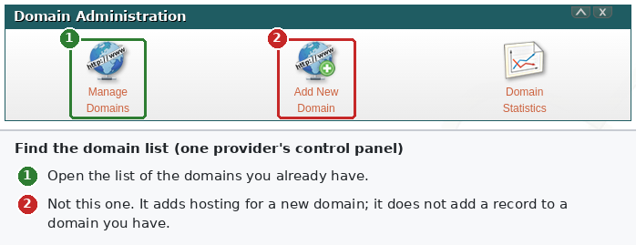
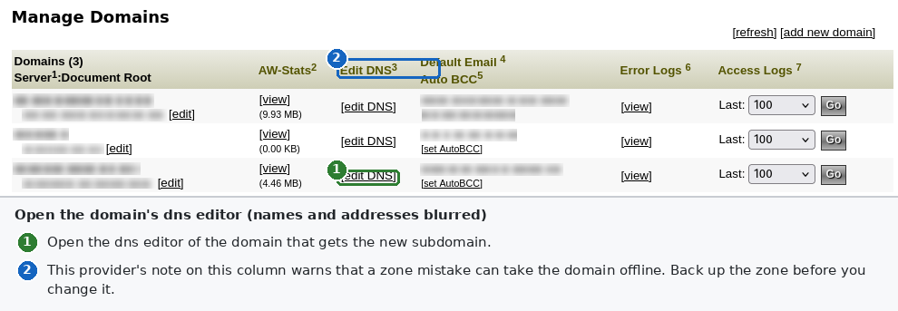
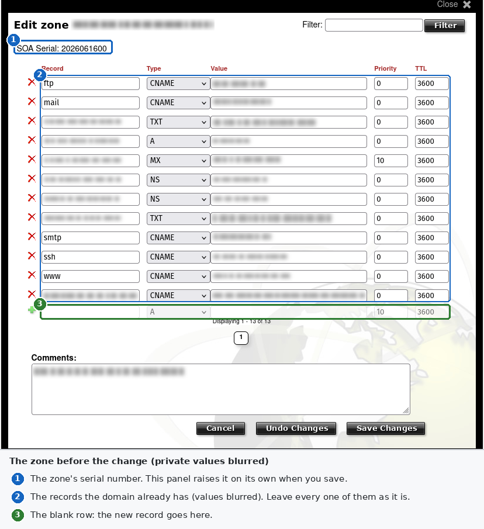
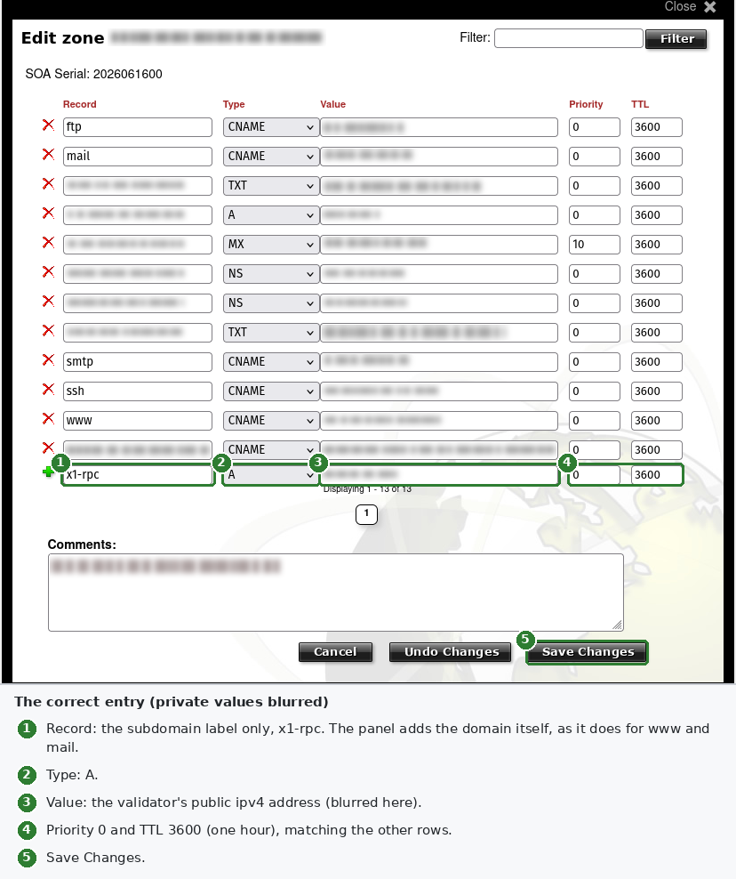
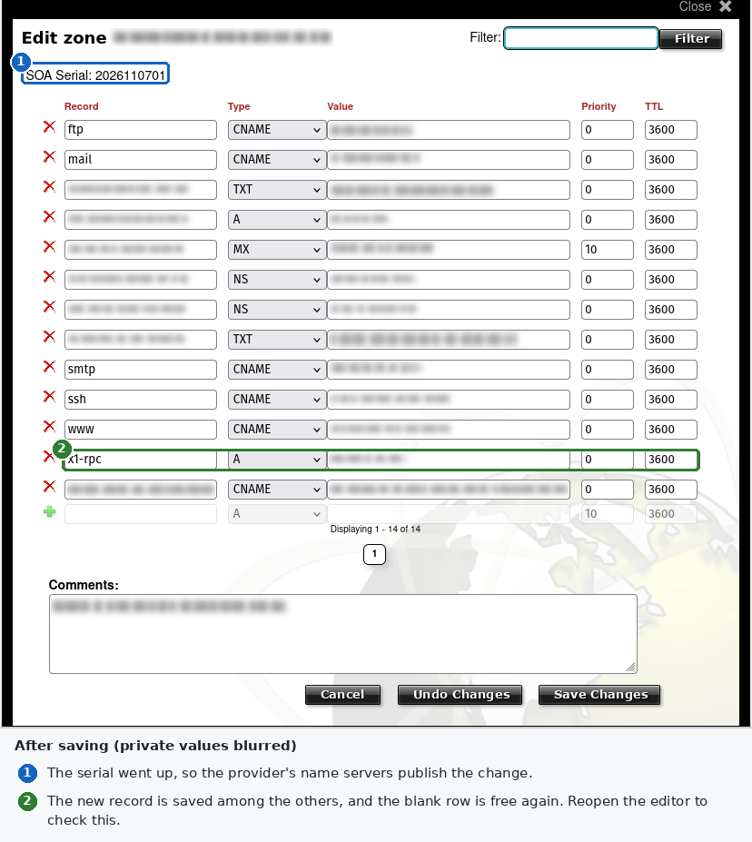
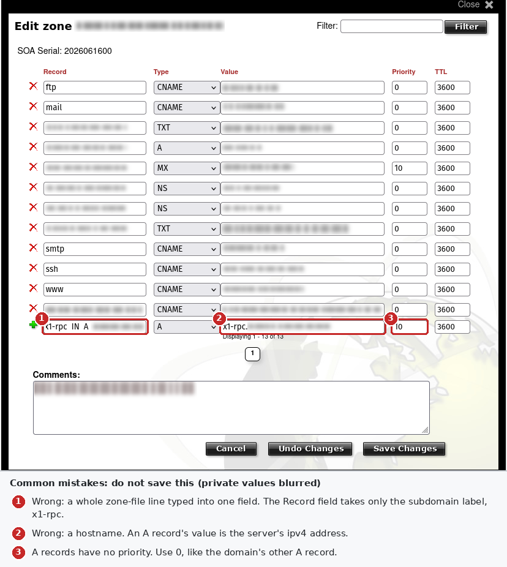

# Manual Domain Setup

x1-validator-private-rpc needs one dns record, which you add by hand at your dns provider before you run `apply`. This guide shows how, for form-based and raw zone-file editors alike.

## What You Are Setting Up

You are adding one dns record. It is an `A` record that points a new name under a domain you own, such as `x1-rpc.example.com`, at the validator's public ipv4 address. nginx on the validator uses that name to get a tls certificate, and your clients use it in the rpc url.

dns maps names to addresses. It never sees url paths. So a path such as `https://example.com/x1-rpc` cannot point at the validator. Whatever web server answers for `example.com` today would have to forward that path to the validator. Most shared hosting cannot do that, and it would put that host in the middle of every rpc request. A subdomain is a separate name instead. Adding it changes nothing about the domain's website, its mail or any other record.

## Before You Start

### Choose the Subdomain

- Any label works: letters, digits and hyphens, at most 63 characters, not starting or ending with a hyphen. This guide uses `x1-rpc`.
- The name will become public. Certificate authorities record every certificate they issue in public certificate transparency logs, which anyone can search by domain. Scanners will find the name, and nginx will answer them with a 403. The key protects the rpc, not the name, so an obscure name adds nothing.
- Make sure the name is not already in use. Look it up first, as in [Verifying the Record](#verifying-the-record).

### Find the Server's Public Address

- Your data center's control panel shows the server's public ipv4 address.
- On the server, `ip -4 addr` shows the same address on its main network interface. If it shows only a private address, the server sits behind address translation, which the tool doesn't support.
- `apply` checks the record against the `publicIp` setting when you set it, and otherwise against the address the X1 network sees for the validator. It stops when the record names another address.
- Use only the ipv4 address. Do not add an `AAAA` (ipv6) record: nginx listens on the ipv4 address alone.

### Find Who Hosts Your Dns

The records live with whoever runs the domain's name servers. That is often the registrar where you bought the domain. It can also be your web host, or a dns service. To find out, ask for the domain's `NS` records:

```bash
dig +short NS example.com
```

The answer names the provider's name servers, such as `ns1.dns-provider.example.`. Log in to that provider's control panel. If `dig` is missing, install it with `sudo apt install bind9-dnsutils` on Ubuntu or Debian, or use `nslookup -type=NS example.com`, which Windows and macOS include.

### Check for Records That Get in the Way

Look through the zone's existing records for these:

- **Any record with the same name.** A name that has a `CNAME` can have no other record. Remove or rename the old one, or choose another label.
- **A wildcard (`*`).** A wildcard answers for every name that has no record of its own, so a lookup of your new name may succeed before you add anything. Your own record overrides the wildcard for that name. Check the address a lookup returns, not only whether it returns one.
- **`CAA` records.** They list the certificate authorities allowed to issue certificates for the domain. If there are any, one must allow `letsencrypt.org`, the authority the tool uses. If there are none, any authority may issue, and nothing needs adding.
- **An `AAAA` record** for the same name, or a wildcard one. nginx listens on the ipv4 address alone, so clients that follow an `AAAA` record never reach it, even when the record names your server. Remove it.

### Back Up the Zone

Save the whole zone before changing anything:

- If the panel can export the zone file, export it.
- Otherwise copy every record's text into a file. A screenshot helps, but panels cut off long values on screen, such as domain-verification records. Copy those fields' full text.
- Note the zone's `SOA` serial number if the panel shows it.

## Form-Based Dns Editors

Most panels show the zone as rows of fields, one row per record, with a blank row or an Add button for a new one. The images below come from one provider's editor, with every private value blurred.

### Open the Zone Editor

Open the list of domains you already have. Do not use the panel's option for adding a new domain: that sets up hosting for a domain, and adds no record to one you have.



Then open the dns editor of the domain that gets the subdomain. Some providers warn on this page that a zone mistake can take the domain offline. That is the reason for the backup.



### Field Names Across Providers

| You need | The field may be called | What to enter |
| --- | --- | --- |
| The new name | Record, Name, Host, Hostname, Subdomain, Label | `x1-rpc`, or the full `x1-rpc.example.com` if the other rows show full names |
| The record type | Type | `A` |
| The address | Value, Points to, Address, IPv4 address, Target, Data, Content | `203.0.113.10` |
| How long others may cache it | TTL | `3600` (one hour), or the panel's default |
| Priority, weight or port | Priority, Pref, Weight, Port | Nothing: `A` records have none. Enter `0`, or leave it blank |

Follow the style of the rows already there. If your other subdomains, such as `www` and `mail`, show as bare labels, enter the bare label. The panel adds the domain. If they show full names, enter the full name. Add a trailing dot only if the other rows have one.

### Adding the Record

1. Open the zone and find the blank row or the Add button.

   

2. Fill in the name, the type `A`, the address, the TTL and the priority, as in the table above.

   

3. If the row has its own add button, such as a plus sign, click it. Then save the zone.
4. Reopen the editor. Check that the new row is there, and that every other row is unchanged.
5. If the panel shows a serial number, check that it went up. Panels like this one raise it themselves.

   

### Mistakes to Avoid



- **A whole zone-file line in one field.** A line such as `x1-rpc 3600 IN A 203.0.113.10` belongs in a raw editor. In a form, the name field holds only `x1-rpc`.
- **A hostname as the value.** An `A` record's value is an ipv4 address. A name there belongs to a `CNAME` record, which is not what you want here.
- **Changed rows.** Leave the domain's existing `A`, `MX`, `NS` and `TXT` records alone. They run its website and mail.
- **Redirect records.** Types such as url redirect, forwarding or parking are web redirects run by the provider, not dns records. They send browsers elsewhere and break rpc clients.
- **A proxy or cdn switch.** Some providers can route a record's traffic through their own servers, often shown as a cloud icon. Set the record to dns only. Otherwise the provider sits in the middle of every rpc request, with its own timeouts and certificate handling.

## Raw Zone-File Editors

Some panels show the zone as text, in the zone-file format of BIND, the classic dns server. They often warn that errors can take the domain offline. They can: a syntax error can stop the whole zone from loading, website and mail included. Work from your backup, and change one line.

### The Record Line

Add one line, at the end or next to the other `A` records:

```text
x1-rpc    3600    IN    A    203.0.113.10
```

The fields are the name, the TTL in seconds, the class `IN`, the type and the address. The TTL may be left out, and the zone's `$TTL` line then applies. Spaces or tabs may separate the fields.

### Relative and Absolute Names

- A name without a final dot is relative, and the zone's origin is appended to it. `x1-rpc` becomes `x1-rpc.example.com.`.
- A name with a final dot is absolute, and is used as it stands: `x1-rpc.example.com.`.
- So a full name without the final dot goes wrong. `x1-rpc.example.com` becomes `x1-rpc.example.com.example.com.`. Use the short form, or the full form with the dot.
- A `$ORIGIN` line changes what gets appended to the names after it. If the file has one, read it before adding your line.

### The SOA Serial

The `SOA` record near the top of the file carries a serial number. A provider's secondary name servers copy the zone only when the serial goes up. A change made without a higher serial may never reach them, so some lookups keep the old answer.

- A common format is the date followed by a two-digit counter, such as `2026010101` for the first change on 2026-01-01.
- Whatever the format, the new serial must be higher than the old one. Adding one always works.
- Some panels raise the serial for you. Check it after saving.

### Checking the File

If the panel has a check or preview button, use it. With a copy of the zone on a Linux machine, BIND's own checker reports errors without loading anything. It comes in the `bind9-utils` package:

```bash
named-checkzone example.com example.com.zone
```

## Provider Settings That Matter

- **The proxy or cdn switch:** dns only, as in [Mistakes to Avoid](#mistakes-to-avoid).
- **DNSSEC:** nothing to do. Panels that sign zones sign new records too.
- **Records the host manages for you:** some hosts write certain records themselves. If your new record disappears after a while, look for such a feature in the panel.
- **A move between dns providers:** while a domain's `NS` records are changing, add the record at both the old and the new provider.

## Verifying the Record

Check from a machine other than the validator, and from the validator too:

```bash
getent hosts x1-rpc.example.com
dig +short x1-rpc.example.com
dig +short x1-rpc.example.com @ns1.dns-provider.example
```

- `getent` uses the machine's usual resolver, and is always installed on Linux.
- The second line asks your resolver. The third asks the provider's name server directly, bypassing every cache. If the third answers and the others do not yet, wait.
- Expect exactly the server's address. Another address means a wildcard or an old record. No answer means the record was not saved, or is not visible yet.
- New names usually appear within minutes. If you looked the name up before creating it, your resolver may remember that it did not exist. It keeps that answer for the zone's negative-caching time, the last number in its `SOA` record, often an hour.

## Certificates and the New Hostname

Once the name resolves to the server and port 443 is open, nginx's ACME module gets a certificate by itself, within seconds of nginx's first start. It proves control of the name through port 443 alone, so port 80 stays closed. It renews the certificate before it expires. For that:

- The name must resolve to this server, with no stray `AAAA` record.
- Port 443 must reach nginx from the internet.
- `CAA` records, if any, must allow the certificate authority.

Fix the dns before starting nginx with the site. Certificate authorities limit failed attempts. nginx logs the module's progress to `/var/log/x1-validator-private-rpc/nginx-error.log`.

## Changing or Removing the Record

- To move the rpc to another server, change the record's address. Clients follow once the TTL has run out.
- A day before a planned move, lower the TTL to `300`, five minutes. Raise it again afterwards.
- To stop using the name, delete the record and run `undo-apply`, as the README's [Uninstall](../README.md#uninstall) section shows.

## Troubleshooting

| Symptom | Likely cause | What to do |
| --- | --- | --- |
| The lookup returns nothing | Record not saved, a typo in the name, or a remembered "no such name" | Reopen the zone, check the name, ask the provider's name server directly, wait out the negative cache |
| The lookup returns another address | A wildcard, an old record, or a full name without its final dot in a raw zone | Search the zone for the name and for `*`, then fix the line |
| The panel refuses the record | A `CNAME` with the same name, a hostname as an `A` value, or invalid characters | Remove the conflict, and put the address in the value field |
| Works on one machine, not another | Caching | Wait for the TTL, and compare with the provider's name server |
| nginx gets no certificate | The name resolves elsewhere, port 443 is closed, `CAA` leaves the authority out, or a stray `AAAA` | Check each one, then read nginx's error log |
| The browser warns about the certificate | nginx has no certificate yet, the certificate is still from Let's Encrypt's staging service, or the configuration names another host | Check the hostname in the configuration; after staging, run `apply` without `--acme-staging` |
| The whole domain stopped working after a raw edit | A syntax error, or a serial that did not go up | Restore the backup, then add the one line again with care |
